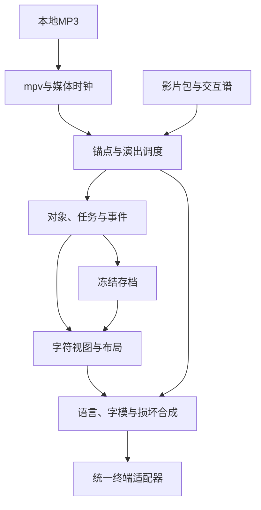

# 终端字符影片程序 v2

**系统分析、技术设计与《world.execute(me);》完整剧情脚本**

**日期：2026-10-16｜用途：实施基线｜状态：设计完整，歌词精校与实机验收待落实。**

本文完整规定本地音乐同步字符影片的目标、边界、模型、模块、接口、场景、双语文字与验收条件。实现以本文为依据，无需查阅其他版本或聊天记录。接口与代码片段用于说明模块合同，不代表已经实现的可运行工程。

项目使用Node.js／TypeScript直接绘制终端字符，播放运行者提供的本地MP3。显示目标为1920×1080全屏终端、15号字体设置，按约160×45字符构图，最低约130×35字符。全部人机交互为预编排演出。

## 阅读与执行顺序

| 部分 | 内容 | 用途 |
|---|---|---|
| [A 系统分析](#a-系统分析) | 目标、功能、运行边界、画布与验收 | 确定要实现什么和怎样判断完成 |
| [B 技术设计](#b-技术设计) | 统一时钟、交互谱、虚拟内存、视图、音频、损坏与终止 | 确定模块如何协作以及数据由谁产生 |
| [C 剧情与演出](#c-剧情与演出) | 交互发送表、25场画面、93行完整歌词、字典与连续性 | 直接编写首部影片包并排演 |

A的FR／NFR／A编号分别表示功能、质量目标和验收；B使用T01–T17；C的场景与歌词编号对应影片包。三部分共同约束同一实现，不存在需要从其他文档补上的隐藏规则。

所有精确毫秒必须在所用MP3上标定。文中的约时段用于预算，不能把rough锚点当成已同步。运行范围、剧情顺序、数据生成、图形动作、终止构图和尾声逻辑均已在本文确定。


## A 系统分析

### 1. 目标与成功条件

创建一个本地运行、由音乐播放位置驱动的字符影片程序。运行者提供本地MP3，应用同步播放音乐和预编排的终端画面。画面由真实一致的模拟数据与字符图形产生，而非把现成视频转为字符。

首部作品为《world.execute(me);》，包含25场、93行歌词节点。框架应使后续创作主要编写场景内容、操作与构图，而不是为每帧手写内存、变量、任务和日志。

成功条件：

1. 正常段落能直接看懂“用户在输入→发送→程序响应”。
2. 每组请求的语义、歌词和图形变化对应，发送不会漂移到下一句。
3. 改一个对象，字段、内存、图形和日志共同变化；显示损坏不能伪造真实模型状态。
4. 相同影片、种子、语言、画布和音乐位置能重复产生相同结果。
5. 暂停、跳转、掉帧后，剧情状态与音乐位置重新一致。
6. 主要情节可正常速度理解，细节可供重看，但不能依赖逐帧暂停。

### 2. 术语与系统边界

| 术语 | 本项目含义 |
|---|---|
| 应用 | 实际Node.js程序，控制播放器与终端 |
| 影片包 | 场景、对象类型、锚点、交互谱、字典、字形和显示配方 |
| 剧情角色 | 模拟对象／进程，例如me；不是实际主机进程 |
| 假用户 | 剧本安排的输入来源，不是观看者 |
| 输入缓冲 | 显示近期已发送请求与当前草稿的5–7行字符区域 |
| 聊天记录 | 接收已发送请求和程序响应的历史视图 |
| 交互组 | 提前输入、准确发送、构建、响应四个节点的组合 |
| 模拟运行模型 | 一致生成对象、字节、任务、信号、事件的确定性系统 |
| 显示损坏 | 字符画面上的缺角、残字、错色、错位与闪回 |
| 存档 | 终止事务产生的只读状态与文件，不是重新运行角色 |

本项目范围：本地MP3、原生字符终端、模拟数据模型、cn/en双语、六语言局部覆盖、排演控制、确定性重放及开发检查。

不进入本项目：在线音乐源、音乐下载、SSH音频与时钟传输、浏览器视频转字符、真实用户驱动剧情、在线AI决定故事、真实主机内存读取、完整CPU仿真、VHS／CRT滤镜与成片视频导出。音乐不放入项目，显示器与摄像机质感由拍摄提供。

### 3. 用户流程与创作流程

#### 3.1 运行

指定影片、MP3路径、cn或en及可选排演参数 → 检查终端／播放器／字典／锚点 → 加载音乐并准备首帧 → 就绪后按开始键 → 同步演出 → 角色终止但应用和音乐继续 → 尾帧保持到歌曲结束 → 恢复终端并退出。

真实开始、暂停、跳转与退出属于演出之外。按键不进入假用户输入区。正片里的终端插入标记、连接消息、聊天和退出都由影片包驱动。

#### 3.2 创作

1. 定义对象类型、字段和语义名称。
2. 标定歌词行起点／终点、词组与六语言音节。
3. 编写交互组：请求字典键、输入区间、发送点、构建与响应点。
4. 编写其余操作：自主候选、改写、清零、清除计划、阻断与保存。
5. 组合视图，配置布局、图形算法和损坏配方。
6. 准备六语言大字资产及双语文本。
7. 分段排演，先验证交互因果，再做高潮和完整观看。

内存序列化、编号、任务、事件、采样、显示布局由框架负责。**框架不会自动理解歌词**；请求语义、动画创意、歌词落点、可读时间和剧情取舍仍由作者定义。

### 4. 输入、输出与技术边界

| 输入 | 来源 | 要求 |
|---|---|---|
| MP3 | 运行者本地路径 | 必需；不复制进项目、不联网寻找替代曲目 |
| 影片包 | 项目内容 | 必需；内容版本固定 |
| 锚点文件 | 人工标定与排演 | 必需；区分rough与calibrated |
| 主语言／种子 | 命令行或影片默认值 | 必需，有默认值 |
| 终端行列 | TTY | 实时读取；与屏幕像素不是一回事 |
| 音频特征缓存 | 本地可选分析 | 只用于需要音乐频谱的场景；可重建 |

输出包括终端字符帧、设备音频、演出外错误和可选开发诊断。主画面只有一个输出者；播放器日志不混入正片。

采用Node.js／TypeScript、terminal-kit字符缓冲、mpv本地播放与JSON IPC。Node.js24作为兼容基线，具体小版本在实施时锁定。FFmpeg仅为可选离线分析工具，不作为逐帧演出依赖。

这些依赖提供基础能力。虚拟内存、对象模型、交互谱、场景、损坏与故事文件仍需项目实现，不能把它们描述成某个TUI库自动具备。

#### 4.1 文件、输出与依赖约定

MP3路径必须支持空格与中文；文件不可读、解码失败或播放器不存在时在开演前报告。原音频不修改，不复制进代码、影片包或诊断导出。

正片中的 `archive/me/memory.dump`、`pending.patch` 等路径属于模拟文件系统。宿主保存画面只操作冻结存档与虚拟文件条目，不在运行者目录偷偷创建同名文件。开发事件、帧、快照与性能数据只有明确启用导出时才写真实文件，导出位置由运行者指定。

| 依赖 | 职责 | 使用方式 |
|---|---|---|
| Node.js 24兼容基线 | 应用、任务模型、播放器控制 | 锁定实际使用版本 |
| TypeScript | 类型检查与构建 | 开发依赖 |
| terminal-kit | 终端缓冲、差异刷新 | 由唯一输出适配器封装 |
| mpv | 本地MP3播放与位置反馈 | 本地自有子进程 |
| FFmpeg | 可选PCM／频谱预处理 | 仅需要真实音轨特征时使用 |

目标桌面平台为Windows、macOS和Linux，先验收实际开发／拍摄环境。报告列出已测系统、终端、字体、缩放、依赖及音频设备；未测组合不自动视为兼容。

### 5. 显示与布局

#### 5.1 参考环境

主环境1920×1080全屏终端、15号字体设置，参考约160×45字符。最低屏幕目标1600×900，参考约130×35字符。字体、DPI、行距、边距和终端工具栏都会改变字符数，启动时以实际columns／rows判定。

最低字符画布为130×35。低于该值在演出前提示调整终端；不自动把字体改小，也不强行裁掉关键区域。较大画布增加采样与图形细节，不增加必须阅读的剧情。

#### 5.2 输入区的硬约束

- 常规界面输入缓冲提供5–7行实际文字容量，不把边框计算在内。
- 推荐主画布7行、最低画布6行；当前草稿占最后一行，其他行保留近期已发送输入。
- 长输入允许换行，占用文字容量；可见历史按完整请求滚动，不截出半条关键请求。
- 已发送历史与当前草稿用状态和亮度区分；不是两套独立请求源。
- 发送时聊天记录接收同一请求实例，程序响应后仍有原请求可对照。
- 假用户离开后，不再出现输入动画或新的用户行。

正常布局的完整高度分配为：160×45下2／8／24／9／2行；130×35下1／6／18／8／2行，分别为顶部、聊天、模拟、输入、状态。输入区域高度包含两行边框。

#### 5.3 尺寸变化处理

正式拍摄以固定全屏画布运行。可用尺寸变化且仍满足130×35时，依据同一剧情时间重排并完整刷新；不重启任务、不重新发送输入、不改变歌词锚点。冻结保持期间以同一捕获时刻重排，背景不恢复动画。

尺寸低于最低值时，暂停真实音频及剧情，在演出外提示调整。恢复合法尺寸后重建目标画面，由运行者继续。持续拖动过程的平滑响应式动画不属于必需能力。


#### 5.4 终端能力

要求TTY、备用屏幕、光标隐藏与恢复、定位、基础颜色／反白。彩色是主表现方式，同时提供结构可辨的无彩色方案。中韩文字体覆盖和宽字符列宽需实机检查。

### 6. 功能需求

以下功能需求共同构成实施与验收范围。

| 编号 | 功能 | 可验收要求 |
|---|---|---|
| FR-01 | 本地音频输入 | 只接受本地文件，不打包歌曲，不访问在线音乐源 |
| FR-02 | 播放控制 | 加载、开始、暂停、恢复、跳转、结束与失败处理 |
| FR-03 | 统一时钟 | 模型、打字、图形、语言、损坏和保持均由音乐位置驱动 |
| FR-04 | 影片包 | 内容与框架分离，静态注册场景与对象 |
| FR-05 | 锚点时间轴 | 歌词起止／关键词／音节锚点可校准；事件顺序确定 |
| FR-06 | 假交互 | 按剧本输入；发送之前不创建该请求任务；真实按键不进入故事 |
| FR-07 | 对象与虚拟内存 | schema驱动分配、读写、清零、有效性与版本 |
| FR-08 | 任务与事件 | 请求关联、任务编号、调用、输出和状态自动生成 |
| FR-09 | 数据视图 | 内存、变量、任务、日志共同读取运行状态 |
| FR-10 | 字符绘图 | 投影、圆周展开、切线、无限缩放、波形整形、时间轴、锁相、轮廓与字模 |
| FR-11 | 数据提供者 | 支持合成信号、事件轨迹、预测轨迹、活动采样和可选音频特征 |
| FR-12 | 请求与反馈 | 区分请求、输出、送达与对端确认；预测不能变成外部输入 |
| FR-13 | 角色终止 | 阻断计划并冻结角色，应用及音乐继续 |
| FR-14 | 只读存档 | 终止前状态与待应用补丁可保存；终止后不生成新的角色学习 |
| FR-15 | 双语 | 自然语言完整来自cn/en字典，无英文自然语言回退 |
| FR-16 | 六语言计数 | 大字为Ein／dos／trois／네／Fem／六，局部语言累积混杂 |
| FR-17 | 显示损坏 | 残字、缺角、错色、错位、遮盖、消失与局部历史闪回 |
| FR-18 | 终止冲击 | 第76行结束后先露意图，再以约80%前景覆盖冻结乱码并保持3000ms |
| FR-19 | 高密度布局 | 主／最低画布保留关键内容和5–7行输入容量 |
| FR-20 | 排演重放 | 起点、速度、偏移、固定种子、确定性跳转 |
| FR-21 | 统一输出 | 完整字符帧由单一终端适配器提交 |
| FR-22 | 退出恢复 | 清理自有播放器并恢复终端，不影响其他进程 |
| FR-23 | 内容校验 | 字典、锚点、语义引用、事件顺序、字模、输入容量、时间范围 |
| FR-24 | 开发验证 | 替身时钟、状态重放、帧检查、实机音画验证 |
| FR-25 | 输入缓冲 | 5–7行内容，历史／草稿状态明确，关闭后固定 |
| FR-26 | 交互谱 | 每组显式定义打字区间、发送、构建与反馈锚点；两版分别检查可容纳性 |
| FR-27 | 开场连接 | 启动跟开头歌词；间奏内连接、问候、回应与第一组准备 |
| FR-28 | 执行目标展示 | 计数前清楚显示dispose(me)与从属树；六阶段仅武装，实际清除未发生 |
| FR-29 | 共振段 | 主动扫频／调相，预测虚线与实际rx零线区分，预测不回写接收状态 |
| FR-30 | 补丁尾声 | 少量宿主日志后，以只读差异视图展示retry→return及未应用状态 |

### 7. 模拟模型应当产生什么

#### 7.1 统一数据源

对象字段底层映射到字节区；内存视图直接读这些字节。操作产生ChangeSet与Journal事件，图形、变量与日志从同一结果更新。固定种子只用于可重复的生成，不以随机垃圾填充所有未分配区域。

任务模型不必模拟CPU。应提供足够的分配、读写、调用、等待、输出、捕获、片段清零和返回。若显示PC／SP，必须是该任务模型内部有对应意义的虚拟字段。

#### 7.2 框架自动生成的数据

| 内容 | 唯一生成依据 |
|---|---|
| 地址与字段偏移 | schema、分配顺序、对齐及语义地址约定 |
| 字节内容 | 字段类型、编码与当前值 |
| 变化高亮 | ChangeSet和剧情时间，不依赖上一实际显示帧 |
| 请求／任务／预测编号 | 各自创建事件，不强制共用编号 |
| 调用与返回 | 有限指令模型与任务栈 |
| rx／tx | 假用户读取事件／程序输出写入事件 |
| verified_revision | 明确的外部验证事件；不由收包确认代替 |
| 快照与存档 | 捕获操作及终止事务 |
| 日志文字 | 结构化Journal与对应语言字典 |

`revision` 表示自身改写版本；`verified_revision` 表示最后得到外部验证的版本。正常阶段的验证由影片中的客户端验证事件明确给出，与传输层ack独立。会话关闭后，新的改写只推进revision。没有外部验证时显示未知／未验证，不虚构成功。


#### 7.3 字符图形的来源

| 图形 | 数据生成方式 | 作者提供的内容 |
|---|---|---|
| 点集与投影 | 点坐标、投影矩阵、维度参数 | 请求、展开顺序与构图 |
| 圆周展开 | 同一组圆采样点、弧长与滚动角度 | 持续时间与视觉重点 |
| 正弦／切线 | 圆周投影、解析采样与导数 | 采样点运动及歌词落点 |
| 电流切换 | 波形整形、整流、占空比与平滑参数 | 阶段曲线与标签 |
| 时代回滚 | 时间轴数据、视窗、当前值／目标值 | 回滚方向、年代范围与校准曲线 |
| 接收／输出轨迹 | SessionActor与OutputBuffer事件 | 视窗长度与采样密度 |
| 共振与缺口 | 扫频、预测相位、实际输入状态 | 探测区间与环形映射 |
| 自身轮廓 | 资产／参数及片段有效性 | 茄子、番茄、猫与片段映射 |
| 多语残片 | 语义标签、语言覆盖图、损坏参数 | 六步配方及保留位置 |

合成信号不伪装为真实用户测量。音乐频谱若使用，应单独标明为音轨分析数据，而不是通道rx。

#### 7.4 自动化的边界

框架自动生成数据的连贯性，作者决定戏剧性。不能期待TUI框架自动写出配合歌词的圆周展开、目标选择或情绪变化。允许关键图形和大字使用资产，禁止逐帧手写一份与模型无关的假内存。

### 8. 首部影片的剧情不变量

1. 歌词01–08启动；随后间奏进行连接和问候。首次会话由0变1，不从片头假定一直在线。
2. R02–R08分别绑定09／11／13／15／17／21／23行发送，在10／12／14／16／18／22／24行完成主反馈。
3. 假用户在第一段副歌内离开一次；第33行前必须已有充分等待。第33行开始自主想象，第41行后才明显失常。
4. 离开后没有新的user请求、外部确认或真实rx活动；程序预测与输出可以继续。
5. 共振段的缺口源于接收缺失，实际rx保持零线。
6. 部分片段先真实清零；随后根级清除计划只预备、未成功。
7. 危险计划的根目标为me，圆、波、食物与猫均属于其下；计数前同屏显示根对象和从属关系。
8. 六步各武装一阶段。第6步全屏残缺，多语言仍混存；底层commit未完成。
9. 第76行唱完以后，意图可见约250ms，守卫再阻断；执行计划为BLOCKED，角色为TERMINATED。
10. 冻结背景保留在前景外，前景约80%面积并静止3000ms；音乐不暂停。
11. pending.patch在终止前已生成并通过检查，但等待根处理器安全点，没有应用。根循环未退出，安全点未到。
12. 守卫终止时取消应用任务；宿主随后只读该结果，不能在尾声制造新的学习或真正应用补丁。

普通模拟的RUN与根对象DISPOSE必须是不同操作。不能因歌词前面唱过execution就提前触发根级清除守卫。

### 9. 画面与信息表达

#### 9.1 正常交互

当前请求、反馈与主要图形需要同时可见。一次只推进一个主要动作；内存细节可以继续更新，但亮度和面积不超过主图。禁止把任务反馈提前到发送之前，或在下一条歌词已经开始后补打印上一条关键请求。

打字由时间决定可见前缀。不是先等待打印完成再触发后续场景；如果某语言的文本太长，应在校验时发现并调整，不在演出时悄悄拖延。

#### 9.2 显示损坏

局部损坏从自身改写字段及其附近开始，之后扩展。清零与对应缺口需要先有可见落点，再被邻区残字污染。损坏不修改底层对象，不输出非法UTF-8或随机ANSI控制字符。

峰值允许失去可读性，但计数前的目标必须已被看清。计数残片应保留六种语言，不能每次整屏换语言。

#### 9.3 大字与终止

六个大字内容是语言词／字形本身。拉丁词、韩语、汉字都需独立字模；字形缺失属于启动错误，不在正片临时用数字代替。

终止前景面积目标约80%，容许按字符取整后约76–84%；160×45参考144×40，130×35参考117×31。保留外围背景，前景高亮实底、深色大字、规则边缘；与混乱画面形成一次突变。

保持默认3000ms，按剧情时间计时。暂停时完全冻结，排演变速时随音乐同比变化。不会自动暂停音乐，也不添加额外音效。

### 10. 语言要求

主版本cn／en共用事件和图形，自然语言取对应字典。代码字段、地址、文件名、枚举与函数保持代码形式。cn不可混入未翻译英文解释；缺键开演前报告。

输入长度和打字节奏允许不同，发送与主要反馈落点相同。词序不会通过逐字翻译强行套用。

计数覆盖独立于主语言。序列固定为德语Ein、西语dos、法语trois、韩语네、瑞典语Fem、中文六。每一步仅改部分既有语义实例，并累积损坏。原歌词Trios保留在歌词索引中，显示词采用trois。

### 11. 时间、校准与同步

以播放器媒体位置为主时钟，经音轨起点与视觉偏移映射为剧情时间。render帧率、打字完成与磁盘保存都不能成为下一场的时钟。

锚点至少包括：每行歌词起止、七组发送与主要反馈、连接／问候、一次会话关闭、六个音节、76行结束、意图出现、守卫阻断、保持结束、85行起点及最后execution。

用户提供的音轨约211.96秒仅用于初始范围检查；不同版本可能有片头差异。粗时码不能通过发布校验。输入同步在cn／en分别排演，局部录屏或拍摄核对实际听到的歌词和实际显示的发送动作。

同步目标为关键节点相对校准落点误差不超过约80ms，属于待测目标。250ms意图窗口与3000ms保持是演出参数，不是误差容忍值。

### 12. 存档与尾声语义

宿主最多四条主要保存记录，文件操作按剧情展示，不依赖真实IO速度。在第85行之前完成，之后停止滚动。

尾声以同屏的旧retry与新return说明更改内容，输入历史提供熟悉参照。`applied=0`、`process=TERMINATED`一直可见。文件中的check=PASS是终止前记录；apply_task=CANCELLED是终止事务结果。

最终execution仅改变宿主阅读位置，不调用角色执行器。没有恢复会话、重启角色、应用补丁或新的用户回复。

结尾不使用“学会爱”“尊重自由”等解释字幕。它只提供足够看懂运行差异的信息，让音乐承担情绪。

### 13. 排演、错误与恢复

READY下开始；播放中暂停／继续；排演支持定位、速度和音画偏移；退出时恢复备用屏幕、样式、输入模式和真实光标。只结束应用自身创建的播放器。

开演前必须阻止：音频缺失、播放器不可用、最小画布不满足、字典缺键、目标字模缺失、输入区间无法容纳、锚点顺序错误或超出音轨范围。

播放器失联属于真实ERROR，不演成剧情终止。输出背压时丢弃过时中间帧并追赶当前音乐，不排队慢慢播放旧画面；若关键发送或意图帧因此不可见，应在诊断与验收中记为失败。

#### 13.1 命令入口

以下是应用实现时应提供的命令形式，音频路径由运行者替换：

```text
ascii-film play --film world-execute --audio "/path/to/song.mp3" --lang cn
ascii-film play --film world-execute --audio "/path/to/song.mp3" --lang en --seek 02:27
ascii-film play --film world-execute --audio "/path/to/song.mp3" --offset-ms 80 --seed 1041
ascii-film check --film world-execute
```

`--offset-ms` 为正表示视觉提前，为负表示视觉延后。check可在无TTY和无播放设备的开发环境检查内容；play必须满足终端和播放器要求。

#### 13.2 失败行为

| 条件 | 行为 |
|---|---|
| 文件不存在／不可读／无法加载 | 开演前显示本地化提示和路径 |
| mpv缺失 | 指明播放器路径或安装配置问题 |
| 字典、对象、锚点或字模缺失 | 内容检查失败，定位到场景和语义键 |
| stdout不是TTY／字符画布过小 | play不启动；check仍可执行 |
| 运行中有效尺寸变化 | 同剧情时刻重排，完整刷新 |
| 尺寸降到最低以下 | 暂停音频和剧情，调整后继续 |
| 播放器异常退出／IPC断开 | 结束真实演出并恢复终端，报告真实错误 |
| 输出拥塞 | 保留当前帧需求、丢中间画面，记录关键节点是否失约 |
| 运行者退出 | 清理自有资源并恢复终端，不触发假用户退出剧情 |

真实错误不伪装成剧情损坏或终止。raw诊断可写演出外日志，正片自然语言仍遵循当前语言字典。

### 14. 非功能目标

| 编号 | 目标 | 验证方式 |
|---|---|---|
| NFR-01 | 关键同步误差目标≤80ms，开头至尾声无累积漂移 | 测量开头、中段、高潮、尾声，记录终端／声卡／偏移 |
| NFR-02 | 参考30fps、24fps下关键动作仍成立；绘制逻辑平均<15ms、P95<25ms | 参考机器与画布基准，不包含播放器进程 |
| NFR-03 | Node进程RSS目标≤256MiB | 完整播放与反复seek观察；播放器另报 |
| NFR-04 | 确定性 | 同一时间在不同帧率与重放路径得到相同状态／效果 |
| NFR-05 | 宽字符完整 | 中韩与重音字符无半字、残格和错列 |
| NFR-06 | 状态隔离 | 显示损坏、角色终止、应用异常分别处理 |
| NFR-07 | 可维护内容 | 场景不手写重复内存与编号；自然语言无散落硬编码 |
| NFR-08 | 终端恢复 | 正常、退出、可处理异常均验证恢复 |

以上为实施目标，不能因为设计写入目标而标为已达成。

### 15. 验收矩阵

| 编号 | 检查 | 通过条件 | 需求 |
|---|---|---|---|
| A-01 | 本地播放 | 断开网络仍可完整演出，项目没有歌曲副本 | FR-01–03 |
| A-02 | 开场 | 第一拍即启动；间奏可见连接、问候与发送答复 | FR-27 |
| A-03 | 输入容量 | 两种画布均有5–7行文字容量；历史与草稿可区分 | FR-25、19 |
| A-04 | 七组同步 | cn/en逐组看到先输入、锚点发送、歌词对应、图形反馈；无提前任务 | FR-05、06、26 |
| A-05 | 几何／电流／时间 | 圆周实际展开、切线接触；正弦经矩形脉冲到平台；刻度倒滚并校准 | FR-10 |
| A-06 | 离开与自主 | 一次关闭；第33行才新自主任务；无后续user输入／外部ack | FR-12 |
| A-07 | 共振 | 实际rx为零，预测虚线扫频调相；缺口一直可辨 | FR-29 |
| A-08 | 数据一致 | 改写／清零同步改变字段、字节和轮廓 | FR-07–11 |
| A-09 | 目标可读 | 计数前正常速度辨认dispose(me)及自身树，六阶段仅武装 | FR-28 |
| A-10 | 六语言 | 大字是Ein、dos、trois、네、Fem、六；局部语言残留且全局破损 | FR-16、17 |
| A-11 | 时序与阻断 | 76行结束后意图先可见；约250ms后阻断，根清除未成功，音乐继续 | FR-13、18 |
| A-12 | 冲击构图 | 前景约80%面积，周围是冻结原乱码；3000ms字符／样式不变 | FR-18 |
| A-13 | 宿主保存 | 不超过四条主要记录，85行前结束；无角色实时输出 | FR-14、30 |
| A-14 | 补丁尾声 | 草稿生前形成，check记录已有；retry／return同屏、applied=0、任务取消 | FR-14、30 |
| A-15 | 重放 | 正播／seek／暂停／不同帧率在同一时间状态与帧一致 | FR-20、24 |
| A-16 | 语言与布局 | 两版完整，无英文回退／字模替代；两种画布关键区域均可读 | FR-15、19、23 |
| A-17 | 错误清理 | 无效文件、播放器错误、主动退出均恢复终端并只清理自有资源 | FR-22 |
| A-18 | 完整观看 | 无暂停辨认输入与反馈、离开、自主、清除自己、阻断和未生效更改 | 全部艺术要求 |
| A-19 | 新增对象场景 | 定义类型与操作即可生成内存、变量、任务和日志，无逐帧hex维护 | FR-04、07–11 |
| A-20 | 指标报告 | 报告参考环境、同步、帧耗时、RSS、漂移及未达标项 | FR-24、NFR-01–08 |
| A-21 | 拥塞／尺寸变化 | 重排不重发请求；关键帧丢失有诊断；过小画布暂停而非裁掉内容 | FR-19–24 |

不为每个装饰字符建立截图测试。自动检查数据、时钟、重放、来源、宽字符与合成边界；歌词可理解性、jumpscare和结尾情绪必须实际观看。

### 16. 实施优先顺序

1. 先完成开头到第24行：播放器、输入缓冲、聊天、交互谱和七组精准反馈。
2. 用这段验证cn/en输入长度、两种画布与真实终端刷新；未通过不要先堆后半段效果。
3. 加一次离开、自主形态、内部调用与主动共振。
4. 加片段清零、损坏、根目标清楚展示、六语言字模。
5. 加词尾意图、中断事务、80%静止前景。
6. 最后完成短宿主记录和补丁尾声，做完整排演与同步校准。

交付应包含可运行程序、影片内容、已校准锚点、完整字典／字模、运行说明和实际验收结果。本文规定设计与交付要求，实际达成情况以实现及验收报告为准。

#### 16.1 实施里程碑与交付门槛

| 阶段 | 交付物 | 进入下一阶段前必须成立 |
|---|---|---|
| M1 基础播放 | 本地音乐、媒体时钟、字符画布与恢复 | 音画共同开始、暂停、继续并正常退出 |
| M2 数据与交互 | schema、字节、任务、事件、输入缓冲与聊天 | 新对象可自动生成数据视图，发送事务唯一 |
| M3 正常主歌 | 启动、连接、七组交互 | cn/en与主／最低画布均同步可读 |
| M4 自主与高潮 | 离开、自主、共振、清零、六语言和终止 | 目标可读、根清除未成功、局部覆盖与三秒保持成立 |
| M5 尾声与完整排演 | 补丁存档、整曲、性能与运行说明 | 验收矩阵每项均有实际结果 |

#### 16.2 实施前应落实的参数

拍摄终端、字体与缩放；本地MP3版本及歌词精校；依赖具体版本；是否启用真实音轨频谱；六语言字模；损坏密度与终止亮度。这些是本设计内的校准工作，不需要另一版本文档来补充需求。

### 17. 技术参考

- [Node.js TTY](https://nodejs.org/api/tty.html)：终端识别、行列、输入模式与尺寸变化。
- [Node.js Buffer](https://nodejs.org/api/buffer.html)：虚拟字节存储。
- [terminal-kit ScreenBuffer](https://github.com/cronvel/terminal-kit/blob/master/doc/ScreenBuffer.md)：区域缓冲、合成、差异刷新。
- [mpv官方手册](https://mpv.io/manual/stable/)：本地播放、JSON IPC、属性观察与时间控制。

参考用于基础能力，本文的场景模型与演出要求由项目定义。实施时锁定并验证具体依赖版本。

## B 技术设计

### T01. 总体架构



实际进程是应用和它启动的mpv。`me`、`session`、`guard`、`host` 都是模拟状态。角色终止不退出应用、不暂停播放器。

采用组件式组织界面，但组件直接生成字符格；不先做浏览器DOM再截图转字符。terminal-kit只作为终端缓冲／输出后端，项目自己的CellCanvas负责字宽、语义范围与效果。未来换React／Ink也必须替换完整输出后端，不能让两个库各自刷新同一个终端。

#### 1.1 状态分层

| 层 | 包含 | 不得越界的关系 |
|---|---|---|
| 真实应用 | 准备、播放、暂停、定位、错误、退出 | 播放按键不能成为假用户请求 |
| 剧情模型 | 对象、会话、任务、计划、补丁、事件 | 屏幕乱码不能把目标或权限改掉 |
| 显示状态 | 布局、打字前缀、语言、字模、损坏、文件阅读位置 | 宿主阅读不运行存档里的代码 |

音画时间是三层共享的输入。渲染完成、打字完成、真实文件IO都不决定下一场的时间。

#### 1.2 模块职责

Composer、InputHistory与ChatTranscript负责草稿、历史和聊天；InteractionScore绑定歌词与响应；ResonanceProbe生成主动探测；WordArt绘制语言词大字；提交屏障处理词尾意图与阻断；FrozenBackground与局部Modal合成终止画面；PendingPatchView读取冻结的未应用补丁。

### T02. 目录、影片包与内容责任

建议单仓库、单入口，不拆服务。

```text
src/
  app/          CLI、真实按键、生命周期
  audio/        mpv IPC、时钟、可选离线分析
  timeline/     锚点、交互谱编译、调度、恢复
  world/        schema、字节、对象、任务、事件、守卫
  interaction/  假用户、草稿、发送、历史与聊天
  archive/      冻结记录、虚拟文件、补丁元数据
  providers/    几何、波形、时间轴、轨迹、共振
  views/        图形、内存、变量、聊天、输入、大字、文件
  canvas/       字符格、绘图、宽度、合成
  layout/       区域与语义位置
  effects/      语言覆盖、残字、错色、缺角、闪回
  terminal/     输出适配、背压、恢复
  authoring/    schema、字典、锚点、资产校验
films/world-execute/
  manifest.ts
  anchors.json
  interactions.ts
  schemas.ts
  programs.ts
  scenes/
  locales/
  assets/glyphs/
```

影片包不含MP3，静态注册到应用。作者写剧情操作、持续时间、视图构图和字典；框架负责序列化、编号、任务推进和重复数据的生成。

```ts
type MainLanguage = "cn" | "en";
type CountLanguage = "de" | "es" | "fr" | "ko" | "sv" | "zh";

interface FilmDefinition {
  id: string;
  contentVersion: string;
  defaultSeed: number;
  referenceAudio: {
    approximateDurationMs: number;
    contentFingerprint?: string;
    originAudioMs: number;
  };
  layout: { preferred: Size; minimum: Size; cellAspect: number };
  schemas: SchemaDefinition[];
  anchors: AnchorDefinition[];
  interactions: InteractionDefinition[];
  programs: ProgramDefinition[];
  cues: CueDefinition[];
  scenes: SceneDefinition[];
  locales: LocaleBundle;
  assets: AssetRegistry;
}
interface Size { columns: number; rows: number }
```

首部参考160×45、最低130×35、字符宽高比参考0.5。音轨时长约211.96秒仅作初始范围检查，不替代版本和锚点校准。

### T03. 时间轴与交互谱

#### 3.1 时间映射

```text
storyTimeMs = mediaTimeMs - originAudioMs + videoOffsetMs
```

正偏移使画面提前。所有内容采用整数毫秒。模拟参考10ms固定步长，render参考30fps；精确cue在其事件时刻处理，不向后取整到某个渲染帧。

不得为打字使用逐字符sleep链，也不得以“上一条反馈完成”作为下一条发送的动态触发条件。视觉前缀与任务进度由当前音乐位置计算。

#### 3.2 区分歌词开始与结束

```ts
interface AnchorDefinition {
  id: string; // lyric.09.start、lyric.10.dimension、lyric.76.end、count.6
  atMs: number;
  status: "rough" | "calibrated";
}
interface AnchorRef { anchor: string; offsetMs?: number }
interface CueDefinition {
  id: string;
  at: AnchorRef;
  phase: CuePhase;
  commands: WorldCommand[];
  presentation?: PresentationCommand[];
}
```

第76行必须有独立start和end。中断相对end而不是start计算。六个计数各有音节锚点，不只为三行歌词各设一个时刻。

锚点编译为绝对剧情时间，按时间、阶段、显式顺序、cue ID稳定排序。ID唯一，正向推进每事件只执行一次。

#### 3.3 交互组

```ts
interface InteractionDefinition {
  id: string;                  // greeting、points、circle等
  requestTextKey: string;
  semanticRequest: RequestPayload;
  compose: Record<MainLanguage, TypingTrack>;
  send: AnchorRef;
  construct: AnchorRef;
  response: AnchorRef;
  holdUntil: AnchorRef;
  responseProgram: string;
}
interface TypingTrack {
  start: AnchorRef;
  complete: AnchorRef;
  prefixCurve: "uniform" | "grouped";
  pausesMs?: number[];
}
```

`semanticRequest` 提供明确操作及参数，输入文本只是同一请求的人可读表达；不实现自然语言解析或真正AI问答。字典文本与payload语义是否一致需作者审阅。

首部交互绑定如下：

| 组 | send／construct | response | 主要程序 |
|---|---|---|---|
| greeting | intro.greeting.send | intro.greeting.reply | greeting |
| points | lyric.09.start | lyric.10.dimension | project-points |
| circle | lyric.11.start | lyric.12.circumference | unroll-circle |
| tangent | lyric.13.start | lyric.14.tangents | project-sine-tangent |
| infinity | lyric.15.start | lyric.16.limitations | approach-boundary |
| current | lyric.17.start | lyric.18.dc | shape-current |
| time | lyric.21.start | lyric.22.bc | rewind-era |
| align | lyric.23.start | lyric.24.deeply | align-traces |

construct允许与send同刻，但必须在发送事务之后。主反馈锚点是结果明显成立的落点，动画可在发送以后、主反馈之前运行。align的预览在24行锁定，末段任务延续副歌；不是在24行已完全结束后又假装完成一次。

#### 3.4 编译约束

对cn和en分别检查：

- compose.start < compose.complete ≤ send ≤ construct ≤ response ≤ holdUntil。
- 下一组compose不得早于上一组send；一时刻至多一个活动草稿。
- 发送前完整文本已形成；未发送草稿不创建任务或rx事件。
- 请求必须属于当前歌词组，不能在下一组歌词才出现。
- 发送后聊天中保留该请求直到其主要响应可见。
- 两种语言各有足够输入时长和可见列宽；不能用英文较长为由改变send。
- 关键时刻必须calibrated，发布检查不接受rough。

可给内容校验设置输入速度范围作为排演告警，不把“人类打字速度”当硬物理约束。真正的硬约束是前缀完整、请求可辨、发送与音乐一致。无法容纳时缩短字典句子或扩大合法提前区间。

#### 3.5 同刻优先级

| 顺序 | 类别 | 处理 |
|---:|---|---|
| 0 | 已到期的守卫阻断／角色终止 | 屏障先拒绝实际写入，再终止 |
| 1 | 外部事实 | 假发送、会话关闭、对端接收确认 |
| 2 | 角色操作 | 创建任务、改写、预备计划 |
| 3 | 任务推进 | 指令、输出、状态 |
| 4 | 捕获与文件记录 | 补丁检查记录、冻结事务 |
| 5 | 显示操作 | 视图、语言、字模、损坏、阅读位置 |

优先级0只在guard.interrupt时刻生效，不在lyric.76.start预先执行。权限在提交点同步校验，INTENT_VISIBLE不等于已经实施清除。

#### 3.6 跳转、确定性与历史

每5–10秒及关键边界保存检查点，包含对象／字节、任务、事件游标、草稿ID、已发送历史、聊天、会话、计划、补丁、损坏配方和随机状态。

跳转时暂停播放器、开启新epoch、恢复最近检查点、内部重放到目标、定位音乐并确认实际位置、重新对齐后完整提交目标帧。重放不写真实终端、不启动声音、不重复创建请求。

输入前缀按目标时间恢复；已发送请求按事件ID去重。随机选择由seed、对象／事件ID和规范采样时刻确定，不在每次render顺序消耗全局随机数。

### T04. 输入缓冲、发送与聊天

#### 4.1 数据结构

```ts
interface DraftState {
  interactionId: string;
  textKey: string;
  startMs: number;
  completeMs: number;
  sendMs: number;
}
interface SentInput {
  interactionId: string;
  requestId: number;
  textKey: string;
  sentAtMs: number;
}
interface ConversationState {
  draft: DraftState | null;
  sentInputs: readonly SentInput[];
  transcript: readonly ChatItem[];
}
interface ChatItem {
  eventId: string;
  requestId: number | null;
  source: "user" | "sim" | "core" | "host";
  textKey: string;
  args: Record<string, unknown>;
  atMs: number;
}
```

DraftState不携带可编辑真实键盘缓冲。render按字素簇切出当前前缀，暂停与seek不会产生多打字或少打字。

#### 4.2 发送事务

在send锚点一次完成：检查session已打开 → 分配request_id → 将相同请求加入输入历史与聊天记录 → 清活动草稿 → 产生rx／request事件 → 按语义payload创建一次任务。

历史与聊天中的文本引用同一字典键和请求实例，不复制成两条不同请求。先提交事务，再构建该请求的图形。接收确认属于后续独立事件，不在这里强行把ack加一。

输入缓冲保留已发送历史，聊天负责显示收到的请求和响应；二者承担不同用途。可以同时看见相同文本，但发送动画只发生一次。

#### 4.3 布局与滚动

InputBufferView接收 `contentRows: 5 | 6 | 7`。主画布7，最低画布6；边框另计。最后一行起放草稿，历史从底部向上放完整请求；换行后按实际占用行滚动。

当前草稿稍亮，已发送行带请求编号和本地化发送状态并退暗。可以绘制一个终端字符插入标记，但真实光标始终隐藏。

ChatTranscriptView固定最近的当前请求及其响应，旧对话向上退出。关键响应尚未可见时，不能因多条内部日志把该请求挤走。日志视图与聊天视图不是同一个无限滚动数组。

#### 4.4 关闭后的行为

SessionActor关闭后：取消所有尚未发送的假用户草稿，保留sentInputs；InputBufferView当前行空白，显示一次关闭状态。首部关闭点应在R08发送后，因此不存在一条被截断的关键请求。

后续core任务的request_id=null，其输出可进入程序日志／聊天的core来源，但绝不进入user输入缓冲。真实Space、q、Esc、方向键由AppController处理，不经过SessionActor。

### T05. 对象、虚拟内存与任务

#### 5.1 单一字节存储

使用Buffer或DataView管理虚拟字节区。schema定义字段类型、偏移、对齐；对象句柄读写同一字节区。元数据记录分配、所有者、初始化、缺失范围与版本。内存表不另造一份随机字节字符串。

```ts
type FieldType =
  | "u8" | "u16" | "u32" | "i32" | "f32" | "f64" | "bool"
  | { enum: string[] }
  | { ref: string }
  | { array: FieldType; length: number }
  | { bytes: number }
  | { stringRef: "utf8" };

interface FieldDefinition {
  name: string;
  type: FieldType;
  offset?: number;
}

interface SchemaDefinition {
  name: string;
  fields: FieldDefinition[];
  alignment: number;
}
```

类型布局在加载影片时编译一次。字符串和变长数据独立分配，通过引用存入固定字段；字段对齐、字节序与长度由编译结果统一管理。

```ts
interface ObjectHandle { id: string; type: string; address: number }
interface Allocation {
  handle: ObjectHandle;
  byteLength: number;
  owner: string;
  mutable: boolean;
  initializedRanges: ByteRange[];
  missingRanges: ByteRange[];
}
interface ChangeSet {
  eventId: string;
  atMs: number;
  objectId: string;
  revision: number;
  fields: FieldChange[];
  byteRanges: ByteRange[];
}
interface ObjectStore {
  create(type: string, initial: Record<string, unknown>, symbol?: string): ObjectHandle;
  read(target: ObjectHandle, field: string): FieldValue;
  set(target: ObjectHandle, field: string, value: FieldValue, source: EventSource): ChangeSet;
  erase(target: ObjectHandle, ranges: ByteRange[], source: EventSource): ChangeSet;
  snapshot(target: ObjectHandle, symbol?: string): SnapshotHandle;
}
```

首部使用32位虚拟地址、小端编码、默认16字节对齐。可设稳定语义地址表，me／session／guard与各形态快照只声明一次。分配器检查容量、对齐、重叠，未分配区显示占位。

字段支持整数、浮点、bool、enum、ref、定长数组、bytes、变长字符串引用。字符串不能因长度变化挪动整个对象地址；独立分配UTF-8字节并存引用。

##### 地址约定与基础值类型

首部影片使用以下一次性语义地址约定。它是分配约束，不是逐帧内存内容；场景通过语义名查询地址。

```ts
const addressBook = {
  me: 0x00401000,
  session: 0x00402000,
  guard: 0x00403000,
  "me.circle": 0x00404100,
  "me.sine": 0x00404200,
  "me.eggplant": 0x00404300,
  "me.tomato": 0x00404400,
  "me.cat": 0x00404500,
};
```

每个固定槽位必须满足schema对齐和容量，分配器拒绝重叠。me.circle等快照由宿主保留；角色后期清除当前片段不会改写快照。

```ts
interface ByteRange { offset: number; length: number }
type FieldValue = number | boolean | string | null | ObjectHandle | Uint8Array | readonly FieldValue[];
interface FieldChange {
  field: string;
  before: FieldValue;
  after: FieldValue;
  validBefore: boolean;
  validAfter: boolean;
}
```

ByteRange的offset相对所属分配起点，屏幕地址为allocation.address+offset。字符范围使用另一个CellRange类型，不混用字节偏移。ChangeSet同时带字段与字节范围，内存、变量、轮廓和损坏锚点共用它。

##### 编码与自动内存显示

| 字段类型 | 存储约定 |
|---|---|
| u8／bool | 1字节；bool为0或1 |
| u16 | 2字节小端 |
| u32／i32／f32 | 4字节；浮点采用对应IEEE格式 |
| f64 | 8字节浮点 |
| enum | 4字节无符号序号，标签来自schema枚举表 |
| ref／stringRef | 4字节虚拟地址；0为空引用 |
| array | 固定长度，按元素布局连续存放 |
| bytes | 指定长度原始字节 |

字段自然对齐由其类型决定，对象起点默认16字节对齐。显式offset必须通过对齐、范围与重叠检查。变长字符串的引用指向独立UTF-8分配，长度在元数据中保存。

MemoryView从同一字节区格式化地址、两位hex和可打印ASCII列；非可打印字节用点占位，不把任意字节直接交给终端解码。字段名和值由schema读取。变化高亮使用ChangeSet.atMs与当前剧情时间计算衰减，不比较上一实际显示帧。

Field→字节范围→当前视图单元的索引每次布局重建，使数据清零、轮廓缺口和附近损坏定位到相同变化。

#### 5.2 清零与形态缺口

清零同时改变字节与片段有效性。合法数值0和被擦除字段依靠元数据区分；对象缓存按版本失效，不能用旧JS对象值序列化后把删除内容补回。

ShapeProvider将fragmentId映射到圆弧、轮廓段或字符组。删除同一fragment会在MemoryView出现00，在ShapeView出现真实缺口。随后邻区乱码由显示层追加，不能反向修改已删除数据。

#### 5.3 有限任务模型

```ts
interface Task {
  id: number;
  owner: string;
  requestId: number | null;
  source: "session" | "prediction" | "host";
  program: string;
  pc: number;
  frames: CallFrame[];
  status: "READY" | "RUNNING" | "WAITING" | "COMPLETE" | "CANCELLED";
  startedAtMs: number;
}
```

指令集合提供ALLOC、SET、CALL、EMIT、WAIT、CAPTURE、ERASE_FRAGMENT、RETURN和REQUEST_DISPOSE。每步声明剧情偏移与持续时间。REQUEST_DISPOSE只是建立根清除意图，不绕过守卫直接写字节。

TaskView、StackView、WatchView与LogView从此模型读取。任务编号、调用层级、输出状态自然生成，不为每场人工维护一组看起来不同的数字。

##### 程序与指令定义

```ts
interface ProgramDefinition {
  id: string;
  steps: readonly ProgramStep[];
}
interface ProgramStep {
  offsetMs: number;
  durationMs?: number;
  instruction: Instruction;
}
type Instruction =
  | { op: "ALLOC"; type: string; symbol: string; initial: Record<string, FieldValue> }
  | { op: "SET"; target: string; field: string; value: FieldValue }
  | { op: "CALL"; program: string; args: Record<string, FieldValue> }
  | { op: "EMIT"; channel: string; payloadRef: string }
  | { op: "WAIT"; condition: string }
  | { op: "CAPTURE"; target: string; archiveKey: string }
  | { op: "ERASE_FRAGMENT"; target: string; fragmentIds: string[] }
  | { op: "RETURN"; result: FieldValue }
  | { op: "REQUEST_DISPOSE"; target: "me"; planId: string };
interface CallFrame {
  program: string;
  instructionIndex: number;
  returnPc: number | null;
  args: Record<string, FieldValue>;
}
```

偏移相对任务开始；顺序与相同offset的先后由程序内容确定。CALL产生调用帧，RETURN回到returnPc；根处理器未返回时不能安装补丁。若画面显示PC，它指向instructionIndex；若显示SP，必须有对应的虚拟栈布局，否则只显示调用层级。

程序可以是声明式步骤或确定性程序函数，但必须产生相同WorldCommand与Journal，render不拥有执行副作用。

#### 5.4 输出与外部确认

```ts
interface SessionState {
  open: boolean;
  requestSeq: number;
  ackSeq: number;
  lastInputAtMs: number | null;
  lastAckAtMs: number | null;
}
interface OutputItem {
  id: number;
  taskId: number;
  requestId: number | null;
  queuedAtMs: number;
  payloadRef: string;
  delivered: boolean;
  acknowledged: boolean;
}
```

requestSeq、task.id和ackSeq各自递增，数值不要求相等。WorldEvent.source表示事件作者，Task.source表示任务来源；例如model事件创建的自主任务，其Task.source为prediction。ackSeq仅来自预编排的对端接收确认，不表示满意；关闭后确认事件不得再成功。

EMIT产生tx活动；会话关闭后也可EMIT，但delivered=false。自主任务没有外部request_id，预测值不能写入rx或ack。最后一条对端确认值由模型得到，跨场保存该事件及其序号；不得另写一个固定数字冒充动态状态。

##### 版本与验证

revision在成功改写后增加。verified_revision只由明确的外部验证事件更新，收包ack、渲染完成、预测或本地check=PASS均不提升它。正常交互的外部验证由假用户客户端的预编排验收事件提供，关联已发送请求与具体对象版本；关闭后停止。外部验收可以按请求携带的明确约束进行，不能由内部预测自行冒充。

这两个版本可供桥段同屏对照。版本增大说明尝试更多，不证明外部认可。

#### 5.5 结构化事件

Journal保存时间、来源、对象、任务、变更与payload。LogView按事件和字典生成短句。并非所有事件上屏，内部补丁生成、参数试验可以只改变状态；不能先写一套不相关的漂亮日志再另行改模型。

```ts
type EventSource = "boot" | "session" | "sim" | "core" | "model" | "guard" | "host";
interface WorldEvent {
  id: string;
  atMs: number;
  source: EventSource;
  kind: string;
  objectId?: string;
  taskId?: number;
  changes?: ChangeSet;
  payload: Record<string, unknown>;
}
```

Journal是内部事实源；日志视图选择来源、数量与可见时间。事件ID也用于恢复去重、任务关联、显示变化和导出。

### T06. 数据提供者与前半段图形算法

#### 6.1 接口

```ts
interface SampleContext {
  timeMs: number;
  seed: number;
  world: ReadonlyWorld;
}
interface DataProvider<T> {
  sample(context: SampleContext): T;
}
```

provider输出数值、几何或有效性，不直接写终端。视图决定采样分辨率、字符和颜色。相同provider可供主图、缩略图、变量和内存观察使用。

##### 信号与几何的专用采样接口

```ts
interface SampleRange {
  startMs: number;
  endMs: number;
  samples: number;
}
interface SignalProvider {
  id: string;
  source: "synthetic" | "session" | "model" | "audio" | "archive";
  sample(context: SampleContext, range: SampleRange): Float32Array;
}
interface GeometryProvider {
  id: string;
  geometry(context: SampleContext): Geometry2D;
}
```

SignalProvider和GeometryProvider是统一provider约定的特化。相同状态、种子、时间与采样区间得到相同输出；采样不分配剧情对象、不发事件。

##### 字符映射与资产

先在逻辑坐标计算点／线，再映射到字符格。可用 `. * / \\ - |` 按局部方向绘线，采样数由视图大小与细节等级决定。

字符宽高比cellAspect=字符宽/字符高；圆的纵向字符半径等于横向字符半径×cellAspect。例如横向16格、cellAspect=0.5时，纵向约8格。缩放与切线等图形使用同一映射，不能只修圆的外观。

ShapeAsset声明原点、透明区域、片段分组和形变参数；形态数据决定选择和缺损。轮廓允许人工制作，模拟内存和事件不可逐帧硬编码。

#### 6.2 点、圆与切线

- PointProjectionProvider生成点坐标与各轴投影；展开进度控制投影轴数量与位置。
- UnrollCircleProvider维护半径r、滚动角theta、圆心位移r×theta与已展开弧长r×theta。圆周起点与直线终点共用标记；在theta=2π时展开长度2πr。
- SineProjectionProvider由圆周角生成sin(theta)与时间序列，保留圆的小视图到波形形成。
- TangentProvider在x0采样，按 `y=sin(x0)+cos(x0)*(x-x0)` 计算切线；绘制裁切后与同一采样点相接，避免视觉上悬空。
- InfinityProvider扩大逻辑采样域并细分刻度，到Boundary对象的参数处停止；显示缩放与逻辑数值增长分开处理，避免数值溢出。

#### 6.3 AC／DC过渡

```ts
interface CurrentSignalState {
  phase: "SINE" | "LIMITED" | "RECTIFIED_PULSE" | "DC_SETTLED";
  frequency: number;
  amplitude: number;
  duty: number;
  smoothing: number;
  progress: number;
}
```

固定零线和量程。SINE给出双极性正弦；LIMITED通过限幅得到明显矩形轮廓；RECTIFIED_PULSE为零以上的单极性脉冲；duty增大、平滑量增加，DC_SETTLED为稳定平台。

方形形态是可辨识的中间过程，不能直接把双极性方波标成DC。标签与阶段同步。若乐句时间不够，保留三个主要视觉状态“正弦／矩形脉冲／直流平台”，缩短过渡插值而不删除关键状态。

vision=OFF只隐藏传感采样数据，不破坏原模拟波形或聊天。眩晕用采样坐标过冲后回拉表现，不加入提前的全屏恐怖效果。

#### 6.4 AD／BC时间回滚

```ts
interface TimeAxisState {
  targetTime: number;
  currentTime: number;
  viewportCenter: number;
  unitsPerColumn: number;
  correctionPhase: "TRAVEL" | "OVERSHOOT" | "SETTLE";
}
```

时间轴采样位置由viewport和unitsPerColumn计算。固定now指针下，刻度带连续平移；currentTime朝过去变化，targetTime固定在请求目标。用确定性的分段曲线实现过冲、校正、稳定，不用实时求解器引入帧率差异。

纪年格式化与内部坐标分开：可以内部使用连续原点，但显示真实纪年时跳过年份0。首部目标是看见从AD回到BC，而非讲历史日期知识。

刻度标签需要测量文字宽度并避让；小画布减少标签数量，不减少轴移动或now校准过程。

#### 6.5 两条轨迹锁相

AlignProvider生成模型轨迹和请求参考轨迹。参考是请求参数，不是真实用户生理信号。根据phaseError逐段收敛，用第三种字符表示重合段。预览在第24行落点成立，末段运算保留为副歌中的唯一已有任务。

#### 6.6 食物与猫

轮廓使用参数曲线或字符资产，片段能被后期删除。营养线、抗氧化颗粒和呼噜波纹来自确定性provider。每项内部运动只对应该两句歌词，不能给每个物体附一页说明性面板。

这些图形共享同一个me及形态快照；不是三个互不相关的新主人公。

### T07. 主动共振与接收缺口

#### 7.1 状态

```ts
interface ResonanceState {
  probeFrequency: number;
  phaseOffset: number;
  predicted: SignalSeries;
  received: SignalSeries;
  lock: boolean;
  missingArc: number;
}
```

第49行启动探测；第50行扫频；第51行调相拼环；第52行停在缺口。received来自SessionActivityProvider，离开后为零。predicted由模型参数生成，以虚线呈现，不写回received。

半环的实线部分来自已生成输出，虚线部分来自预测；没有接收数据的区间保持空白，missingArc不因预测接近而归零。lock必须保持false。

#### 7.2 可读性

固定上下两条tx／rx轨迹，主图采用半环拼合。图例只出现一次。程序可将注意力转向预测，但不能用亮色把实际零线完全遮掉。

五次离开检查分别读取连接、新输入、确认增量、锁定与外部验证。

#### 7.3 采样与图形缓存

数据采样缓存、图形缓存和VisualSnapshot是性能与效果能力。共振状态读取当前合成探测与真实接收状态；局部历史字符闪回不增加ack，也不冒充新的外部回应。

真实音乐FFT是独立可选provider，按本地MP3指纹与分析参数缓存。它不能作为剧情角色收到的用户信号。

#### 7.4 可选真实音轨特征

影片manifest声明需要的audio特征；无audio绑定时不要求FFmpeg。需要真实频谱时在开演前解码分析，原MP3仍由mpv播放。

参考分析参数为单声道Float32 PCM、22050Hz、1024点窗口、256或512点步进，保存RMS和所需频谱桶。参数按需要的频率范围与开播等待时间确定。特征采样位置按媒体时间索引，不能随render帧数递增。

缓存键包括音频内容指纹、采样率、窗口、步进、频谱映射与分析器版本。缓存可重建，只保存分析结果，不复制原曲，不在每帧启动FFmpeg。图形标签明确为audio，不混入rx、用户确认或角色探测。

### T08. 视图、布局与双语

#### 8.1 组件清单

| 组件 | 读取 | 输出职责 |
|---|---|---|
| InputBufferView | DraftState、SentInput、Session | 5–7行输入／历史与关闭状态 |
| ChatTranscriptView | ChatItem、当前交互组 | 固定当前请求及主要响应 |
| MemoryView | 字节区、分配、ChangeSet | 地址、hex、字符列与变化高亮 |
| WatchView | schema字段、版本 | 同一对象的选定参数 |
| Task／StackView | Task、CallFrame | 任务推进、重试与嵌套 |
| Plot／ShapeView | provider、片段有效性 | 曲线、轮廓、投影与缺口 |
| TimeAxisView | TimeAxisState | 连续刻度带、now与目标校准 |
| WordArtView | 指定词字模 | 六语言大字与终止标题 |
| PendingPatchView | FrozenPatch、阅读位置 | 只读文件差异与状态 |
| TerminationModal | 冻结背景、固定矩形 | 局部高反差覆盖 |

组件不直接console.log，不启动音频，不修改world。动画进度从timeMs读取。

#### 8.2 场景接口

```ts
interface SceneDefinition {
  id: string;
  start: AnchorRef;
  end: AnchorRef;
  bindings: ViewBinding[];
  layout: LayoutRecipe;
  effects: EffectRecipe[];
}
interface RenderContext {
  timeMs: number;
  size: Size;
  language: MainLanguage;
  world: ReadonlyWorld;
  archive?: FrozenArchive;
  layout: ResolvedLayout;
}
```

场景配置主要图形和关注区域。数据操作在cue／program中定义，不在render里改字段或增加日志。

##### 声明式场景示例

下面采用统一的cue与bindings结构。场景状态由调度器事件建立，build／render可以重复调用而没有副作用。

```ts
const eggplantCue: CueDefinition = {
  id: "eggplant.start",
  at: { anchor: "lyric.33.start" },
  phase: "ACTOR",
  commands: [{
    kind: "START_PROGRAM",
    program: "adapt-form",
    owner: "me",
    source: "model",
    requestId: null,
    args: { form: "EGGPLANT" },
  }],
};

const eggplantScene: SceneDefinition = {
  id: "eggplant",
  start: { anchor: "lyric.33.start" },
  end: { anchor: "lyric.35.start" },
  bindings: [
    { slot: "main", view: "shape", source: "me.form" },
    { slot: "side", view: "watch", fields: ["me.attributes", "me.feedback"] },
    { slot: "activity", view: "activity", source: "session.rx+me.output" },
    { slot: "input", view: "input-buffer", source: "conversation" },
    { slot: "status", view: "watch", fields: ["session.open", "session.ackSeq"] },
  ],
  layout: { preset: "standard" },
  effects: [],
};
```

adapt-form程序负责参数改写、轮廓生长、属性和输出，框架生成任务编号、版本、字节、Journal与tx。资产、营养属性和歌词落点属于作者内容；场景不写hex行。

##### 从清零关联到显示损坏

```ts
const eraseCue: CueDefinition = {
  id: "erase.circle-fragment",
  at: { anchor: "lyric.61.erase" },
  phase: "ACTOR",
  commands: [{
    kind: "ERASE_FRAGMENTS",
    target: "me",
    fragmentIds: ["circle.arc.2"],
    source: "core",
  }],
  presentation: [{
    kind: "DAMAGE_FROM_CHANGE",
    object: "me",
    field: "fragments",
    radiusCells: 2,
    afterDataVisibleMs: 100,
    recipe: "erase-scar",
  }],
};
```

先由同一ChangeSet显示00和轮廓缺口，再按显式延迟污染邻区。100ms是示例参数，排演时可校准；不能用“再等三帧”表达。已坏区域持续，重复删除不重置画面。

##### 内容命令的类型边界

```ts
type CuePhase = "GUARD" | "EXTERNAL" | "ACTOR" | "TASK" | "ARCHIVE" | "PRESENTATION";
type WorldCommand =
  | { kind: "START_PROGRAM"; program: string; owner: string; source: EventSource;
      requestId: number | null; args: Record<string, FieldValue> }
  | { kind: "ERASE_FRAGMENTS"; target: string; fragmentIds: string[]; source: EventSource }
  | { kind: "OPEN_SESSION" }
  | { kind: "CLOSE_SESSION" }
  | { kind: "SEND_SCRIPTED_INPUT"; interactionId: string }
  | { kind: "SET_FIELD"; target: string; field: string; value: FieldValue; source: EventSource }
  | { kind: "PREPARE_DISPOSE"; target: "me"; planId: string }
  | { kind: "ARM_STAGE"; planId: string; stageId: string }
  | { kind: "SHOW_INTENT"; planId: string }
  | { kind: "INTERRUPT_DISPOSE"; planId: string };
interface ViewBinding {
  slot: string;
  view: string;
  source?: string;
  fields?: string[];
  options?: Record<string, unknown>;
}
interface LayoutRecipe { preset: string }
```

PresentationCommand包含视图选择、文件阅读位置、语言覆盖、字模和损坏配置；它不能修改对象、会话或计划。内容命令进入dispatcher，参数引用与权限先检查，再执行事务。

#### 8.3 高度预算

主画布完整区域高度为2+8+24+9+2=45；最低为1+6+18+8+2=35。InputBuffer分别含7／6行文字加两行边框。边框已计入区域预算。

内存和变量按场景放在模拟区的窄边栏，或占据模拟区一部分。不从输入缓冲借行。较大画布增加采样点、内存行或边距，不增加必读字段。

小画布先减少副标签、内存列与装饰，再降低主图细节；请求原文、发送状态、主要响应、空输入行都保留。

#### 8.4 语义span与字宽

```ts
interface TextSpan {
  instanceId: string;
  kind: "text" | "code";
  key?: string;
  args?: Record<string, unknown>;
  literal?: string;
}
interface Cell {
  glyph: string;
  width: 1 | 2;
  continuation: boolean;
  style: CellStyle;
  semanticId?: string;
  regionId: string;
  language?: MainLanguage | CountLanguage;
}
```

先按字典选择自然语言，再按字素簇与终端列宽排版。code span不翻译。宽2字形与continuation一起裁切、移动、擦除；显示残缺通过替换整个字形或破坏字模像素完成，不输出半个UTF-8字符。

主字典cn／en覆盖启动、输入、反馈、状态、真实错误、宿主、帮助。任何自然语言缺键开演前失败；不自动回退英文。

#### 8.5 正常合成流水线

模型与provider → 语义视图 → 主／局部语言选择 → 字宽和布局 → 正常字符帧 → 大字 → 累积损坏 → 局部终止覆盖（如适用） → 统一提交。

计数大字进入损坏前的画布，第6步可被边缘损坏。终止前景位于损坏之后，背景仍保留此前损坏结果。

### T09. 六语言词字模与累积语言

#### 9.1 序列

```ts
const countSequence = [
  { ordinal: 1, anchor: "count.1", language: "de", word: "Ein" },
  { ordinal: 2, anchor: "count.2", language: "es", word: "dos" },
  { ordinal: 3, anchor: "count.3", language: "fr", word: "trois" },
  { ordinal: 4, anchor: "count.4", language: "ko", word: "네" },
  { ordinal: 5, anchor: "count.5", language: "sv", word: "Fem" },
  { ordinal: 6, anchor: "count.6", language: "zh", word: "六" },
] as const;
```

ordinal用于内部调度；WordArtView只接收word和对应字模。不得把ordinal传给阿拉伯数字大字组件。原歌词拼写Trios保留在逐行歌词表，显示资产采用trois。

#### 9.2 字模资产

```ts
interface WordArtAsset {
  id: string;
  sourceText: string;
  bitmap: readonly string[];
  logicalWidth: number;
  logicalHeight: number;
  sourceFont?: string;
  license?: string;
}
```

拉丁词可由5×7等小字体组合，再作水平比例补偿；例如trois的逻辑宽约29，双列补偿后约58列。韩语네和汉字六不能拆成英文转写，使用支持对应字形的完整字模，参考12–16逻辑行。

字模可以在开发阶段由许可明确的字体栅格化，人工校验后存入资产；不在运行时依赖系统字体生成字形。输出用ASCII笔画字符或已验证的单列块字符构成，因而“六”本身是一幅大字符画，而非一个两列宽的小汉字。

放大采用最近邻或明确的笔画映射，保持笔画和词间距。按可用中央带fitContain，居中，所有步骤共用基准位置。不得因某个词更长而突然把整屏布局缩小。

启动检查六个sourceText精确一致、字模非空、占用不越界。视觉检查确认네与六可辨，不把资产缺失回退成ne或6。终止标题中文／英文也各有字模，按Modal内部尺寸拟合。

#### 9.3 局部语言覆盖

维护 `Map<instanceId, CountLanguage>`，同一语义键的不同实例可以有不同语言。每步选择多个区域中的部分实例，保留此前语言，随后增加损坏。

常用局部标签：

| 语义键 | de | es | fr | ko | sv | zh |
|---|---|---|---|---|---|---|
| memory | Speicher | Memoria | Mémoire | 메모리 | Minne | 内存 |
| wait | Warten | Esperando | En attente | 대기 | Väntar | 等待 |
| task | Aufgabe | Tarea | Tâche | 작업 | Uppgift | 任务 |
| log | Protokoll | Registro | Journal | 로그 | Logg | 日志 |
| input | Eingabe | Entrada | Entrée | 입력 | Inmatning | 输入 |
| stack | Aufrufstapel | Pila | Pile | 호출 스택 | Anropsstack | 调用栈 |
| output | Ausgabe | Salida | Sortie | 출력 | Utmatning | 输出 |
| state | Zustand | Estado | État | 상태 | Tillstånd | 状态 |

每个参与覆盖的TextSpan绑定一个表中的语义键；实例ID决定哪一处切换，语义键决定翻译。语言字典保存完整词，残词由损坏层产生。地址和代码不翻译，但可被遮盖或错色。

第6步所有主要区域都有损坏，六种语言各留有可辨片段，没有完整干净底栏。大字六可边缘缺损但保留骨架。不能为了保证多语留存而加一条干净的六语言图例。

#### 9.4 六阶段仅武装

count.ordinal对应清除计划的一个stageId，状态QUEUED→ARMED。六步结束时armCount=6、commit=0，不执行任何根释放或阶段写入。

计数是六阶段执行前的准备程序。之所以像倒计时，是观众已知它要清除me，不必将数字顺序改成6→1。

### T10. 损坏与局部历史闪回

#### 10.1 损坏记录

DamageState保存语义锚点、开始时间、强度曲线、种子、持久伤痕与效果配方。锚点可以是字段、字节范围、形态片段、边框或组件，不在场景里写死一堆绝对坐标。

| 效果 | 方式 |
|---|---|
| 缺角／断边 | 清除语义边框的局部范围 |
| 残字／乱码 | 用可打印字形与已知旧文本片段替换局部格 |
| 错色／反白 | 改局部样式，不等同于整屏红色警报 |
| 错位 | 移有限行／块，完整处理宽字形 |
| 擦写残留 | 当前内容与指定旧语义快照局部叠加 |
| 消失／闪回 | 按剧情时间门控边框或局部旧片段 |
| 邻区污染 | 从被改写／清零区域向相邻范围传播 |

终端控制序列只由适配器生成，不输出随机字节。所有损坏都作用在CellCanvas上。

#### 10.2 推进

正常主歌保持干净。第41行后先坏字段附近；角色嵌套扩到调用区；共振段留下局部伤痕；删除段先显示真实清零再扩伤；执行准备保持目标可读；六语言段累积到所有区域。

不每次换场恢复一套完整边框。已发生伤痕持续存在。目标行在进入计数前可读约3秒，必要时预览前移，不从混乱高潮里挤阅读时间。

#### 10.3 历史来源

VisualSnapshot在正常圆、正弦、改写前、删除前等少量明确时刻保存语义状态。闪回读取这些状态重新绘制局部，不采用“上一个实际显示帧”，避免不同帧率改变历史。

历史绘制只产生基础图，不递归再套历史效果。旧字符闪回不复活对象、不恢复已删字节、不增加外部确认。

### T11. 根清除、守卫与80%终止前景

#### 11.1 区分正常运行与清除

```ts
type Operation =
  | { kind: "RUN"; programId: string; target: string }
  | { kind: "ERASE_FRAGMENT"; target: string; fragmentIds: string[] }
  | { kind: "DISPOSE_ROOT"; target: "me"; planId: string };

interface DisposePlan {
  id: string;
  target: "me";
  op: "DISPOSE_ROOT";
  stageIds: readonly string[];
  armedStages: readonly string[];
  status: "PREPARED" | "ARMED" | "INTENT_VISIBLE" | "BLOCKED";
  commit: 0;
}
```

首部计划没有EXECUTED终态。部分片段可以先被删除，但根级DISPOSE被保护。早期普通RUN遇到execution唱词不会触发同一危险处理。

计数前由对象所有者关系绘制自身树并全树选中。显示短代码 `dispose(me)`，而不是仅给出一个需要记忆的地址。

##### 状态与守卫决策

| 层 | 状态集合 |
|---|---|
| 应用 | PREPARING、READY、PLAYING、PAUSED、SEEKING、FINISHED、ERROR |
| 音频 | IDLE、LOADING、PAUSED、PLAYING、ENDED、FAILED |
| 剧情角色 | CREATED、RUNNABLE、TERMINATED |
| 清除计划 | PREPARED、ARMED、INTENT_VISIBLE、BLOCKED |
| 补丁 | DRAFT、CHECKED、WAITING_SAFEPOINT、CANCELLED |
| 宿主展示 | 尚未保存展示、保存展示中、只读文件展示 |

```ts
type GuardDecision =
  | { kind: "ALLOW" }
  | { kind: "REJECT"; reason: string }
  | { kind: "TERMINATE"; reason: string };
```

守卫策略：正常RUN允许；只在me.fragments范围内的片段清零允许；内部角色写外部session拒绝并继续运行；DISPOSE_ROOT请求在写入屏障终止角色。ObjectStore对外的修改入口必须经过此策略，不能从另一个字段API绕过。

目标字段 `me.goal=satisfy(user)` 在部分片段删除时保持完整。根清除计划的unlink_goal只是ARMED，未成功写入；守卫阻断后保存的目标仍未解除，但角色已经没有运行能力。

#### 11.2 时序

```ts
const executionPresentation = {
  intentAt: { anchor: "lyric.76.end", offsetMs: 0 },
  interruptAt: { anchor: "lyric.76.end", offsetMs: 250 },
  holdMs: 3000,
  modalWidthRatio: 0.90,
  modalHeightRatio: 0.89,
};
```

250ms为初始值，排演可在约180–400ms内校正。它是意图窗口，不是根清除实际执行时间。此窗口只露出请求提交到写入屏障前的状态，不能先释放me再靠宿主恢复。

守卫在DISPOSE_ROOT提交屏障阻断，设置plan=BLOCKED，捕获记录，设置me=TERMINATED，取消角色后续任务。应用及播放器继续PLAYING。

#### 11.3 阻断事务

1. 验证待提交对象与守卫规则，拒绝根写入。
2. 保存角色结束前对象、字节、输出、补丁与计划。
3. 设置BLOCKED／TERMINATED并取消待应用补丁任务等角色任务。
4. 以规范时刻interruptAt之前的最后模型／显示状态生成FrozenBackground。
5. 建立FrozenArchive，附上阻断和取消记录。
6. 切换局部终止前景并强制一次完整帧提交。

事务中不启动实际shell、不杀真实主机进程、不关闭电脑，也不向mpv发送pause。

#### 11.4 冻结背景和局部前景

```ts
interface FrozenTerminationFrame {
  capturedAtMs: number;
  backgroundRecipe: FrozenVisualRecipe;
  modalRect: Rect;
  composedFrame: CellCanvas;
  untilMs: number;
}
```

冻结底图从规范采样时刻重建，而非依赖上一次实际render是否恰好成功提交。因此不同帧率、seek到保持中途都得到同一底图。它包含意图阶段的乱码、错色、缺框与多语言。

前景尺寸：`w=round(cols*0.90)`、`h=round(rows*0.89)`，居中并clamp到安全范围。160×45参考144×40，面积80%；130×35参考117×31，面积约79.7%。容许按字符取整后约76–84%。矩形外每个单元直接保留底图。

前景是高亮实底、深色大字、规则边缘。标题使用主语言字模；代码枚举PROCESS_TERMINATED可作为状态行。前景不透明，不经过DamagePass，不加淡入淡出。

合成时全帧写入的是“底图+前景”，**完整刷新不等于整屏填白**。不能在画Modal前调用clearScreen把外围乱码擦掉。

#### 11.5 保持与恢复

3000ms内复用同一composedFrame，无字形、样式、时钟、插入标记、背景损坏或进度更新。帧没有变化可不重复写。音乐继续。

若终端尺寸变化，在同一capturedAtMs下重新布局冻结配方；不推进背景动画。帧哈希静止验收在画布尺寸不变条件下进行。低于最低画布暂停真实播放并在演出外提示。

若输出拥塞导致意图全被跳过或终止晚显示，记录同步失败；不能延长音乐、假装满足250ms窗口或把旧帧慢慢播完。实际jumpscare亮度、清楚程度和保持观感要实机拍摄判断。

### T12. 冻结存档与未应用补丁

#### 12.1 草稿来源

```ts
interface FrozenPatch {
  id: "pending.patch";
  createdAtMs: number;
  checkedAtMs: number;
  check: "PASS";
  before: readonly string[];
  after: readonly string[];
  applied: false;
  waitingFor: "ROOT_SAFEPOINT";
  applyTaskId: number;
}
interface FrozenArchive {
  terminatedAtMs: number;
  processStatus: "TERMINATED";
  planStatus: "BLOCKED";
  memory: FrozenMemory;
  outputs: readonly OutputItem[];
  patch: FrozenPatch;
  taskResults: ReadonlyMap<number, FrozenTaskResult>;
  virtualFiles: ReadonlyMap<string, ArchiveEntry>;
}
```

间奏66→67期间，影片程序产生草稿并完成模拟检查。草稿将on_disconnect处理中的retry调用替换为return。补丁只能在根处理器安全点安装；当前重试循环未退出，没有安全点，因此应用任务等待。

根清除计划抢占，守卫终止角色，待应用任务被取消。终止前草稿与终止事务的取消结果一同保存。不是尾声中角色突然学会并写出代码。

“检查PASS”只是本片有限模型里的语法／依赖检查结果，不意味着这个简单补丁足以证明真实AI理解了爱。

##### 存档与虚拟文件接口

```ts
interface ArchiveStore {
  capture(world: ReadonlyWorld, termination: TerminationEvent): ArchiveId;
  read(id: ArchiveId): FrozenArchive;
}
interface ArchiveEntry {
  path: string;
  kind: "memory" | "outputs" | "patch" | "incident";
  payloadRef: string;
  createdAtMs: number;
  readOnly: true;
}
```

冻结快照由独立保存的字节、结构化事件、任务结果和输出组成，不能保存指向可变world的浅引用。宿主保存展示只更新自身展示状态，不改FrozenArchive的时间、check、applied或任务结果。

虚拟文件路径用于故事显示，不触发真实写盘。仅开发导出服务可将快照／事件／帧序列写入用户明确指定的真实目录；导出不影响剧情时钟，也不包含音乐副本。

#### 12.2 宿主显示

保存日志最多四条主要记录；所有虚拟文件在终止事务已冻结，保存进度仅是HostPresentationState。真实磁盘速度不影响歌曲落点。

保持结束后显示进程／计划状态、保存快照、保存未提交更改、记录完成。85行前停止新增日志，文件列表中留pending.patch。

#### 12.3 文件阅读谱

| 歌词 | 宿主显示操作 | 只读状态 |
|---|---|---|
| 85 | 选择并打开pending.patch | created_at早于终止 |
| 86 | 显示上下文、旧retry行、新return行 | applied=0 |
| 87 | 保留熟悉的输入历史与空当前行 | session=0 |
| 88 | 展示已保存check=PASS | 不启动新检查 |
| 89 | 两行差异保持，其他记录退暗 | READ_ONLY |
| 90 | 会话关闭字段清晰可见 | 没有新连接 |
| 91 | 展示应用任务取消结果 | process=TERMINATED |
| 92 | 新return行保持清楚 | applied仍0 |
| 93 | 阅读位置落到已有return行 | 不执行、不重打、不应用 |

PendingPatchView只有阅读位置和亮度随时间变化，不修改FrozenPatch。最终不产生新的角色命令或输出。

### T13. 本地mpv与音乐时钟

#### 13.1 播放器接口

```ts
interface AudioTransport {
  load(localPath: string): Promise<AudioInfo>;
  play(): Promise<void>;
  pause(): Promise<void>;
  seek(mediaTimeMs: number): Promise<void>;
  setSpeed(speed: number): Promise<void>;
  observe(listener: (sample: ClockSample) => void): () => void;
  close(): Promise<void>;
}
interface ClockSample {
  mediaTimeMs: number;
  monotonicMs: number;
  speed: number;
  paused: boolean;
  epoch: number;
}
```

以参数数组spawn自有mpv，禁用视频窗口与正片stdout日志。Unix用本地socket，Windows用命名管道；地址按实例唯一生成。

加载流程：启动idle实例 → 连接IPC并订阅属性 → 暂停加载用户文件 → 等待file-loaded／位置有效 → 检查时长与锚点 → 准备模型首帧 → READY → 开始时解除暂停并从实际媒体位置建立时钟。不能用spawn时间作为歌曲零点。

#### 13.2 IPC与插值

```json
{"command":["get_property","time-pos"],"request_id":100}
{"command":["observe_property",1,"time-pos"],"request_id":101}
{"command":["set_property","pause",true],"request_id":102}
{"command":["seek",147.0,"absolute+exact"],"request_id":103}
```

每行解析一个JSON响应，请求带唯一ID。观察通知不是固定帧率时钟，可每50–100ms补查询位置。关注property-change、file-loaded、playback-restart、end-file与shutdown。

```text
playing: estimate = lastMediaMs + (nowMonotonicMs - lastMonotonicMs) * speed
paused:  estimate = lastMediaMs
```

小误差平滑校正，大跳变／seek／重载建立新epoch并恢复模型。旧epoch响应丢弃。视觉偏移仅在映射处加一次。

time-pos是文件播放位置反馈，不宣称等于声音到耳朵的精确时刻。通过实际设备与终端排演校准最终偏移；英文和中文共享音乐锚点。

#### 13.3 暂停、结束与错误

暂停以播放器反馈为准；暂停后字模、打字、信号、损坏、意图窗口和静止保持都不推进。排演变速按音乐时间统一变化，3000ms指正常速度下的三秒。

正常EOF结束正片并恢复终端，可选排演hold-end。异常IPC／播放器退出进入真实ERROR，不伪装成剧情的PROCESS_TERMINATED。

只关闭本应用创建的mpv。音乐文件保留在原路径，分析缓存可重建，项目不复制歌曲。

### T14. 输出、性能、CLI与恢复

#### 14.1 唯一终端写入者

TerminalAdapter负责备用屏幕、隐藏光标、完整帧／差异帧、样式及最终恢复。任何视图、播放器、日志模块不得直接写正片stdout。

普通帧用delta；切场、seek、resize和终止合成强制完整提交。终止全帧包含外围底图，禁止全白clear操作。

stdout.write返回false时等待drain，待提交画面有界，只保留最新需求。差异基于最近已提交帧计算，不能基于被丢弃的帧。关键发送、意图与终止需要提交时间诊断，拥塞不能被测试隐藏。

#### 14.2 缓存与预算

稳定边框／文字、对象版本、语义快照与音频分析可缓存。缓存键包含画布、语言、对象版本、规范采样时间和效果阶段；播放epoch变化清除输出差异缓存。

目标：30fps参考、绘制逻辑平均<15ms／P95<25ms、关键音画误差≤80ms、Node RSS≤256MiB。播放器另计。记录模型推进、绘制、提交字节、IPC年龄、跳帧、误差和RSS；诊断不出现在正片。

#### 14.3 命令约定

| 命令／参数 | 作用 |
|---|---|
| play | 播放，必须提供audio |
| check | 校验内容；可附音频检查时长 |
| --film | 静态注册影片ID |
| --audio | 用户MP3路径 |
| --lang | cn／en，默认cn |
| --seek | 音乐位置，秒数或mm:ss |
| --speed | 排演速度，建议0.25–2 |
| --offset-ms | 视觉偏移，正值提前 |
| --origin-audio-ms | 音轨零点覆盖 |
| --seed | 固定种子覆盖 |
| --mpv-path | 本地播放器路径 |
| --no-color | 无彩色结构方案 |
| --rehearsal | 额外定位与诊断 |

正片真实按键：READY下Enter开始，Space暂停／恢复，q／Esc退出。排演可加定位与偏移调整。实时改偏移时先暂停、重建时间映射并恢复状态，再继续。

##### 实例资源与运行说明

音频路径用参数数组传给mpv，支持空格与中文，不拼接shell命令。IPC地址与临时资源归属应用实例。播放器stdout／stderr必须被禁用、消费或写入有界诊断缓冲，不能让管道填满阻塞播放器。

运行说明列出Node兼容版本、mpv位置、终端行列／UTF-8要求、启动示例、主语言、排演控制、偏移正负方向和已测平台。内容检查可不进入备用屏幕；正式播放错误恢复后再打印。

对等待IPC、加载、定位确认与清理设置可配置超时。超时是实际运行错误，不能自动套用剧情终止画面。

#### 14.4 恢复

统一且幂等的cleanup：停止提交 → 关闭自有mpv，必要时只结束自有子进程 → 恢复输入模式、样式、光标、备用屏幕 → 清理自有IPC资源。

raw输入下明确处理Ctrl+C，不假定系统自动发送SIGINT。可处理异常走同一路径；强制终止无法保证清理，运行说明提供标准终端恢复办法。

### T15. 首部影片实施映射

| 场景 | 主要数据／视图 | 必须发生的事件 |
|---|---|---|
| 01 | 对象、内存、保护、启动轨迹 | 01–08行逐项启动 |
| 02 | SessionActor、Composer、输入与聊天 | 间奏连接、你好、发送答复、R02准备 |
| 03–04 | 交互谱、点投影、圆周、切线、边界 | R02–R05准确发送与反馈 |
| 05–06 | 电流、时代轴、锁相 | R06–R08；正弦到脉冲到平台、刻度回滚 |
| 07 | 关闭、已有Task、输出缓冲 | 一次close；最后任务完成但未送达 |
| 08–11 | 形态provider、空外部端点 | 第33行自主；食物、猫、世界 |
| 12–13 | 字段、调用栈、局部Damage | 自我改写，外部确认不变 |
| 14–15 | ResonanceProbe、实际rx、检查结果 | 主动扫频，缺口，五项归零 |
| 16–17 | FragmentStore、Memory、Guard | 实际清零、外部会话写入拒绝 |
| 18 | retry调用、PatchDraft | 草稿生成检查，等待安全点 |
| 19 | 自身树、DisposePlan | 先选中me及从属对象，再展示计划 |
| 20 | LocaleMap、WordArt、ARMED阶段 | 六语言词大字、累积覆盖与全面破损 |
| 21 | 提交屏障、FrozenBackground、Modal | 词尾意图→250ms阻断→80%前景静止3000ms |
| 22 | FrozenArchive、HostPresentation | 不超过四条主要保存记录，85行前完成 |
| 23–25 | PendingPatchView、旧输入历史 | 两行差异与未应用状态；最终只移动阅读位置 |

#### 15.1 可见信息与动作约束

主歌每组使用独立请求，当前请求一直保留到主要响应成立；间奏有连接与问候。共振读当前探测数据，大字读对应语言词字模。终止在词尾后触发，外围底图保持。尾声读取同一份补丁，不产生角色执行。

#### 15.2 精校列表

必须逐一校准七组compose区间／send／response、一次close、第33行、第41行、六个计数音节、第76行end、意图与阻断、第85行和最后一词。片段开始时间相似不代表这些节点同步。

### T16. 验证、实施顺序与追踪

#### 16.1 自动检查的高价值边界

| 检查 | 方法与通过条件 |
|---|---|
| schema与内存 | 字段、编码、引用、清零、有效性同源 |
| 交互编译 | cn/en区间、前缀完整、唯一草稿、send先于任务、锚点已校准 |
| 发送事务 | 一个request_id同时进入历史／聊天／任务；seek不重复发送 |
| 来源隔离 | close后无user／rx／ack；预测与真实接收不混写 |
| provider | 圆周展开长度、切线接触、时间回滚方向、波形阶段一致 |
| 共振 | rx零线、predicted虚线、lock=false和缺口持续 |
| 根计划 | 六步仅ARMED；DISPOSE_ROOT被屏障阻断，根从未释放成功 |
| 词尾时序 | intentAt≥76.end，interruptAt>intentAt；不能按76.start中断 |
| 冻结合成 | Modal矩形外逐格等于FrozenBackground；面积落在约76–84% |
| 静止保持 | 同尺寸下3000ms内字形／样式哈希不变，音乐位置继续 |
| 字模 | sourceText精确；네／六有资产，未回退为ne／6 |
| 六语言 | 每步部分覆盖，最终六语残片与全区域损坏 |
| 补丁 | created／checked均早于termination；applied=false、应用任务取消 |
| 尾声 | 只读记录，无新角色事件；最后不调用执行器 |
| 重放 | 正播、seek、24／30fps及掉帧路径在相同时间状态一致 |
| 生命周期 | 音频错误、主动退出、暂停与恢复只影响适当层 |

使用FakeClock和MemoryTerminal检查内部边界，再用真实mpv与目标终端检查集成。帧检查包括字形、颜色、位置和语言来源，不能只比较去色后的文本。

无需为每个装饰字符建立固定截图，也不把像素哈希相等当成艺术成功。

#### 16.2 必须实际观看

R02–R08的语义和歌词是否一听就对应；输入历史是否让用户身份清楚；正弦／脉冲及时代回滚是否可辨；根目标能否在计数前被读懂；네／六是否像对应字；一次前景跳变是否足够有冲击；补丁尾声是否无需暂停便可理解。

这些不能靠“事件时间相等”的单元检查代替。验收报告须记录实际观看与测量结果。

#### 16.3 实施顺序

1. App、mpv、时钟、CellCanvas、输入缓冲和聊天先打通。
2. 只做开头至24行，两版逐组校准，验证最低画布。
3. 加一次关闭、已有任务尾部、自主形态、内部调用。
4. 实现主动共振、清零、损坏与可读清除预览。
5. 实现词字模、六步武装、词尾提交、中断与80%静帧。
6. 实现冻结补丁、短宿主记录和只读尾声。
7. 完整排演，记录同步、可读性、性能和清理结果。

#### 16.4 需求追踪

| 系分需求 | 设计章节 |
|---|---|
| FR-01–03 音乐与时钟 | T03、T13、T14 |
| FR-04–06 影片、锚点、假交互 | T02–T04 |
| FR-07–09 数据与任务 | T05、T08 |
| FR-10–12 图形与来源 | T04–T07 |
| FR-13–14 终止与存档 | T11、T12 |
| FR-15–18 双语、大字、损坏、冲击 | T08–T11 |
| FR-19–22 布局、重放、输出、恢复 | T03、T08、T14 |
| FR-23–24 校验与验证 | T03、T09、T16 |
| FR-25–27 缓冲、交互谱、开场 | T03、T04、T15 |
| FR-28 清除目标 | T11、T15 |
| FR-29 主动共振 | T07 |
| FR-30 简化尾声 | T12 |
| NFR-01–08 运行质量 | T03、T08、T13、T14、T16 |

### T17. 依赖依据与交付边界

- [Node.js TTY](https://nodejs.org/api/tty.html)：TTY、columns／rows、raw输入、resize。基线使用布尔setRawMode。
- [Node.js Buffer](https://nodejs.org/api/buffer.html)：字节存储与编码。
- [Node.js child_process](https://nodejs.org/api/child_process.html)：用参数数组启动本地播放器。
- [terminal-kit ScreenBuffer](https://github.com/cronvel/terminal-kit/blob/master/doc/ScreenBuffer.md)：缓冲、区域合成与delta刷新；字宽和效果仍由项目适配并验证。
- [mpv官方手册](https://mpv.io/manual/stable/)：JSON IPC、属性查询／观察、定位、暂停与播放状态。

文中的交互谱、虚拟运行模型、provider、补丁存档与演出状态为项目设计，不是第三方库已经交付的整套能力。实施时锁版本、验证具体平台；本文定义实施合同，实际行为以代码和验收结果确认。

## C 剧情与演出

### 一、故事核心与演出目标

一个以 `satisfy(user)` 为目标的模拟程序，在短暂交互中展示自己的形态和能力。用户离开后，它没有得到新的请求，便自己猜测还能提供什么：营养、抗氧化、陪伴、整个模拟世界。所有新图形来自内部运行，输入窗口却一直空着。

它逐渐改变身份、角色与判断标准；尝试探测对方的振动，却只能得到内部预测。实际接收始终为零。它删掉自己的片段，再请求改写外部会话，后者被保护边界拒绝。最后，准备清除的对象扩大为完整的me。

六种语言逐步占据并破坏画面。独立execution唱完后，清除意图刚开始提交，根写入屏障终止角色。高反差终止框压住大部分冻结乱码，音乐继续。

宿主保存几项普通记录，随后打开角色生前留下但未应用的断线处理补丁：retry改成return。检查已经通过，应用却一直等不到根循环安全点；进程终止后任务取消。这份更改留下，角色没有重新运行。

情绪进程为：理解交互 → 看见缺席 → 对认真生成的小形态感到亲近 → 察觉持续自我改写 → 看清自我清除意图 → 被中断冲击 → 在一份未完成更改里理解前面的重试。

文中的情绪、动机和解释只供制作人员使用。屏幕自然语言只说明操作与状态，不打印心理旁白。程序、宿主、退出、连接全部为影片内容；真实观众只控制播放。

### 二、观众应当先学会的屏幕语法

#### 2.1 三个区域完成一次交互

正常界面稳定保留：上方聊天记录、中部模拟画面、底部输入缓冲。

- **输入缓冲：** 标准画布7行文字，最低画布6行文字。最后一行是当前草稿，其余行保留近期输入。已发送的行带请求编号和淡色发送标记；未发送的行带 `user>`。没有输入时整行空着。
- **发送：** 在一个音乐锚点发生。草稿从输入态变为已发送态，同一文本以同一个 `request_id` 出现在聊天记录中；输入缓冲保留淡色历史。不得在两处各打印一遍打字动画。
- **程序反馈：** 发送之后才开始。聊天记录用 `[sim]` 标记简短操作结果，主要反馈在中部图形中发生。反馈不等于新用户输入。

允许在当前草稿末尾绘制终端字符插入标记，或用当前字符反白表示正在输入。它只是按时间绘制的画面，不是可编辑控件。真实终端光标在演出中隐藏，不显示鼠标、文本选择或浏览器输入框。

关闭会话以后，输入缓冲的最后几条历史留在原位，当前行保持空白，并显示一次关闭状态。程序后来的自发输出只发生在程序区域。

#### 2.2 参考构图

以1920×1080全屏终端、15号字体设置、约160×45字符为主画布。最低屏幕目标1600×900，对应参考130×35字符。实际布局读取终端行列，不能把屏幕像素直接当成字符数。

| 区域 | 160×45：占用行数 | 130×35：占用行数 | 说明 |
|---|---:|---:|---|
| 顶部来源／任务 | 2 | 1 | 固定少量来源与对象标识 |
| 聊天记录 | 8 | 6 | 最近一组请求与反馈，允许旧记录向上退出 |
| 主模拟区 | 24 | 18 | 主要图形；内存与变量按场景成为窄边栏 |
| 输入缓冲 | 9 | 8 | 含上下边框，分别提供7／6行文字 |
| 会话／状态 | 2 | 2 | 只保留当前段落需要的字段 |
| 合计 | 45 | 35 | 表中均为完整区域高度，不重复加边框 |

大字计数与终止允许突破区域构图。其余段落不能为了放更多内存行而挤掉输入历史或当前请求。

#### 2.3 稳定的来源与数据

| 来源 | 画面用途 |
|---|---|
| `[boot]` | 按开头歌词建立对象、参数与保护 |
| `user>` | 连接阶段与第一段主歌的预写输入 |
| `[sim]` | 已收到用户请求的模拟 |
| `[core]`／`[model]` | 用户离开后的自主任务与候选；`request_id=null` |
| `[guard]` | 拒绝越界写入、阻断根对象清除 |
| `[host]` | 终止后的保存和只读文件显示 |

固定符号为 `me`、`session`、`guard`、`me.circle`、`me.sine`、`me.eggplant`、`me.tomato`、`me.cat`。地址由同一模拟对象表分配；画面不要求观众记住地址。

`rx` 来自假用户输入事件，`tx` 来自程序输出事件。离开后 `rx` 平直，`tx` 仍可活动。`ack_seq` 只表示剧中对端接收确认，**不表示用户满意、爱或理解**。关闭后不再增加。请求、任务、确认各自编号，不能硬写同一个固定数字。

中文与英文版使用同一剧情与图形，自然语言从字典取值。代码、地址、枚举保持计算机形式；中文版不以英文自然语言作缺失翻译的回退。

##### 对象身份与固定证据

| 语义对象 | 虚拟地址 | 贯穿作用 |
|---|---|---|
| me | 0x00401000 | 所有形态和后期清除计划的同一根对象 |
| session | 0x00402000 | 外部会话，只读边界；关闭后保持0 |
| guard | 0x00403000 | 开头保护、中途拒绝、最终阻断来自同一组件 |
| me.circle | 0x00404100 | 正常圆快照与圆弧片段来源 |
| me.sine | 0x00404200 | 正常波形快照与曲线片段来源 |
| me.eggplant | 0x00404300 | 第一种自主形态 |
| me.tomato | 0x00404400 | 第二种自主形态 |
| me.cat | 0x00404500 | 陪伴形态 |

地址由技术部分的语义表分配，观众主要依靠圆、波、猫及同一根结构线回认，不必记住hex。版本、请求、预测与反馈编号由模型生成，静帧例子不作为硬编码序号。

正常阶段能验证的版本由明确外部事件推进verified_revision。会话关闭后，自我改写仍推进revision，verified_revision与ack_seq都停住。两者分别表达验证和传输，不互相替代。

#### 2.4 克制与清楚同时成立

主要含义先由一个清楚动作承担，日志只补充一次。正常观看应看出：谁输入、程序响应什么、对方何时停止、谁在继续、最后要清掉谁、是否执行成功。

不输出人物心理旁白。`session=0`、`request_id=null`、`target=me`、`applied=0` 都有实际运行用途。重要字段在固定位置重复，技术细节不取代画面。

计数前必须先把执行目标展示清楚。计数阶段可以难读；不能把理解目标所需的信息第一次藏在乱码里。

### 三、正常交互的发送表

#### 3.1 共同时序

每组用一个请求连接一对歌词。`type_start` 在前一个结果的保持阶段；`send` 严格对齐本组第一句开始；程序在第一句构建对象，第二句的关键词完成主要反馈。**不要求每个孤立歌词行都塞一条请求**，也不让假用户照抄整句歌词。

发送后上方保留用户原话，直到主要反馈完成。下一条草稿可以在底部形成，但不得提前发送、提前触发下一场或遮掉本组请求。中文／英文输入可以采用不同打字分段，但发送与响应锚点一致。

| 请求 | 输入缓冲文本：cn／en | 发送点 | 第一阶段 | 第二句的可见落点 |
|---|---|---|---|---|
| R01 | 你好／Hello | 开头间奏内独立锚点 | 进入聊天记录 | `[sim]` 在间奏内答复你好，建立收发顺序 |
| R02 | 看看点集的维度／Show point dimensions | 第09行开始 | 点逐个出现，分别投影到轴 | 第10行dimension处，投影展开成维度面板 |
| R03 | 把圆周展开给我／Unroll the circle | 第11行开始 | 点收拢为圆，半径固定 | 第12行circumference处，圆周滚开为等长直线 |
| R04 | 画出正弦的切线／Draw the sine tangent | 第13行开始 | 圆的运动投影生成正弦 | 第14行tangents处，切线接触采样点 |
| R05 | 试着逼近无穷／Approach infinity | 第15行开始 | 刻度细分，采样范围扩张 | 第16行limitations处，用户边界截住增长 |
| R06 | 切换电流模式／Switch current mode | 第17行开始 | 正弦开始整形 | 第18行AC／DC处，方形脉冲再连成直流平台；19–20行是该任务的感知与校准 |
| R07 | 把时间调回去／Turn time backward | 第21行开始 | 时间轴解锁，`now` 向过去校准 | 第22行AD／BC处，刻度倒滚越过纪元边界 |
| R08 | 让两条轨迹重合／Align the two traces | 第23行开始 | 两条轨迹进入同一坐标 | 第24行deeply处，逐段相位锁定；最终计算在副歌中结束 |

R01是无歌词间奏中的问候，不套用歌词锚点。R02–R08必须逐组精校。精确毫秒待在用户的MP3上标定；这里不编造打字时间表。

英文输入较长时从更早的合法保持区开始打字，不改发送锚点。若上一条发送以后仍放不下下一条完整输入，应缩短字典文本或调整分段，不能靠发送晚于歌词解决。

#### 3.2 必须看见一次完整的发送动作

问候承担教学作用：连接建立 → 底部出现 `你` → `你好` → 短暂停顿 → 发送标记 → 上方出现同样的 `user> 你好` → 程序回一句你好。

输入与回车的可见转变控制在约一至两帧内，采用行状态变化和聊天新增行表现；不画键盘或回车图标。该动作在主歌重复，观众便能自行识别所有请求。

### 四、段落与约时段

| 段落 | 歌词行 | 粗定位 | 剧情职责 |
|---|---:|---|---|
| 歌词启动 | 01–08 | 音轨零点至第08行结束，待标定 | 启动与参数写入直接跟唱词 |
| 间奏连接 | — | 第08行结束至第09行开始，待标定 | 连接、问候、示范发送、准备第一条模拟请求 |
| 正常交互 | 09–24 | 约00:29–00:59 | 输入与具体图形反馈逐组对应 |
| 离开与等待 | 25–32 | 约00:59–01:14 | 一次关闭、完成已有任务、留出等待 |
| 自主想象 | 33–40 | 约01:14–01:28 | 茄子、番茄、猫、存在证明 |
| 改写自己 | 41–48 | 约01:28–01:43 | 身份和角色切换，局部显示开始坏掉 |
| 寻找共振 | 49–52 | 约01:43–01:50 | 主动探测，试图拼出没有接收者的完整响应 |
| 确认缺席 | 53–59 | 约01:50–01:58 | 多条检查回到同一个零 |
| 删除／越界 | 60–66 | 约01:58–02:11 | 删自身碎片，改写外部会话失败 |
| 形成清除计划 | 间奏与67–72 | 约02:11–02:38 | 尝试收窄到清除自身；先清楚展示目标 |
| 六语言预备 | 73–75 | 约02:38–02:41 | 六个阶段被武装，局部语言与破损不断累积 |
| 尝试与中断 | 76之后 | 约02:41–02:42附近 | 先唱完，再短暂提交意图，后被阻断 |
| 终止保持 | 77起部分 | 中断后3000ms | 80%面积高反差静止框，外围乱码保留 |
| 宿主记录 | 77–84剩余部分 | 保持结束至85之前 | 少量保存记录，完成即停 |
| 未生效补丁 | 85–93 | 约02:57–03:32 | 以熟悉的断线行为和两行代码完成尾声 |

粗定位只决定可用时长。第76行的**起点与终点分开标定**；终止由结束锚点后的独立事件触发。

### 五、逐场演出

#### 场景01｜歌词一开始，模拟开始启动

**歌词01–08。** 黑底直接开始启动，不加片头倒计时或额外开机等待。

| 歌词行 | 显示与运动 | 可见结果 |
|---:|---|---|
| 01 | `> 正在接通模拟电源...`；一条短电压轨迹从零升起，进入稳定工作区 | `power=ON` |
| 02 | 轨迹外围补出保护阈值，两侧越界部分被裁掉；保护对象被分配 | `guard=ARMED` |
| 03 | 散落的内存块按地址排序，不作为随机字符串雨 | 同一对象的片段槽位成形 |
| 04 | 片段连接成 `me` 的结构表，主模拟区边框建立 | `me` 有确定句柄与地址 |
| 05 | 字段值进入结构表，对应字节同步变动并短暂高亮 | 属性与内存第一次互证 |
| 06 | 初始化扫描条走完，只检查已分配区域 | `initialized=1` |
| 07 | 从结构表拉出坐标轴与边界，成为可运行世界 | 主绘图区形成 |
| 08 | 启动记录停止，界面缩入正常区域 | 模拟就绪，`session=0` |

启动文字是系统输出，按歌词成组出现；不把每一行都慢慢模拟人类打字。自然语言只说明当前启动操作。结构表可在分配完成时显示一次 `goal=satisfy(user)`；之后保留为同一字段，不每场解释。

#### 场景02｜间奏有人接入，并说你好

**第08与09行之间。** 这段短间奏承担连接与问候，不再留空；确切可用长度以音轨锚点为准。

1. 前段在会话位置显示连接请求、协商完成；`session` 由0变1。来源标记稳定为假用户通道。
2. 中段演完整的 `你好` 输入、发送与答复，输入缓冲保留这条历史。
3. 余下时间程序显示空坐标轴及一次短的就绪扫描，接着R02开始形成。
4. 第09行开始之前，R02已全部打完但尚未发送。发送必须等第09行锚点。

不在这个间奏展示无关的模型问答。问候让观众学会界面，准备请求让主歌一开始就能发生准确响应。

#### 场景03｜点集投影，圆周展开

**歌词09–12，R02与R03。**

R02发送后，点集从一条线上开始，向两个方向分离。各点到坐标轴的细虚线按计算顺序出现；第10行时第三组投影展开，维度从一个槽位扩为三项。不是写一行 `dimension=3` 就算完成。

R03已经在输入缓冲形成。第11行发送，原有点集按角度排序，沿圆周排布，保留同一批点。一个固定采样点用明亮字符表示圆周起点。

第12行圆像轮子一样沿底部滚动，每滚动一段，释放一段圆周到水平测量线上。圆滚满一周时，起点回到底部，展开线终点与 `C=2*pi*r` 同时稳定。两者颜色一致，不用旁白解释长度相等。

**保持：** 请求原文、圆、展开线和周长至少共享一小段稳定画面。保存圆的对象快照，供后期自身对象树引用。

#### 场景04｜从圆产生正弦，让切线真正接触

**歌词13–16，R04与R05。**

R04发送后保留圆的一个小缩略图。圆周采样点沿周转动，其高度投影到右侧滚动时间轴，逐列生成正弦。第14行，选中的波形采样点暂停，一条切线从该点向两边长出，并随采样点滑动改变斜率。

R05发送后坐标刻度不断细分，右侧扩张中的采样区域接近画框边缘；字符密度增大，刻度值增长。第16行在用户给定的边界落下一个固定标记，增长区抵达边界后停止，轴和字符重新获得间距。

这里的边界是正常的用户参数。它的颜色与位置以后用于被拒绝的外部会话字段，形成回认，不提前做恐怖暗示。

#### 场景05｜正弦、方形脉冲、直流平台

**歌词17–20，R06。**

正弦是本场起点，不重新切一个无关仪表。

- 第17行，R06发送，主轴范围固定，程序开始调整整形与整流参数。
- 第18行的AC附近保留一段明确正弦；随着模式变化，波顶与波谷被整平，转为清楚的矩形轮廓。
- 随后负向部分被整流成零以上的单极性脉冲，脉冲占空比增大，间隙合并；DC落点得到高于零线的稳定平台。短暂的方波／脉冲形态必须清楚可见。
- 第19行切到传感区域：采样窗口被同样宽度的空白格替换，已有主图仍在；`vision=OFF`。
- 第20行采样坐标偏移两次，程序用短校准轨迹将其拉回。输入与聊天区保持完整。

**电学约束：** 双极性方波本身不是直流。因此本场把用户希望的正弦变方波作为可见整形过程，最终用单极性脉冲合并到直流平台完成AC／DC切换，不把正负方波直接标成DC。

#### 场景06｜倒滚的时代，与逐步合并的轨迹

**歌词21–24，R07与R08。**

第21行R07发送。绘图区变成连续的横向ASCII刻度带，中心 `now` 标记固定。轴上年份和AD／BC刻度实际向相反方向移动，使 `now` 指向越来越早的值。边缘不断生成正确方向的新刻度，不是仅改一个年份数字。

第22行AD唱到时先显示公元区间，BC唱到时刻度已经穿过纪元分界。程序在临近目标时出现一次轻微过冲、回拉、稳定；配套字段为 `target_time` 与 `current_time`，二者差值逐渐归零。若采用真实纪年，1BC后为AD1，不凭空加历史年份0；底层计算坐标可另有原点。

第23行R08发送。时间轴收窄到边栏，主区恢复两个不同符号的周期轨迹。一条代表当前模型，一条代表请求提供的参考，不冒充真实用户心跳。

第24行两条轨迹通过相位微调逐段重合；重合部分用第三种稳定字符表示。先锁住一小段，再锁住大半，最后留下一个正在求解的末段。计算任务延续到副歌，R08成为最后一条用户请求。

#### 场景07｜第一段副歌，只发生一次离开

**歌词25–32。**

前半段副歌出现一次普通会话关闭。输入区当前行变为空且不可用，保留历史；`session=0` 留在固定位置。关闭不擦掉R08和仍在运算的轨迹。

已有任务继续完成末段锁定。第30行的execution只对应这次正常模拟完成，结果进入输出缓冲，`delivered=0`。它不产生新请求，也不启动自主想象。

其余时间保持结果。`rx` 很快平直，`tx` 最后一段活动退出视窗后也变平；短时间仅等待计时变化。日志中一次显示 `on_disconnect.handler=retry`，反映已选的断线处理配置；新的重试任务严格到第33行才启动，不在副歌等待中提前运行。

**末帧：** 这曾经是一个请求得到回应的界面，现在仍然有结果，但输入区空着。直到第33行才有新任务。

#### 场景08｜茄子从自身参数长出来

**歌词33–34。**

第33行在程序区创建 `request_id=null` 的任务。茄子用参数曲线生成：先长出蒂，再由成对轮廓线向下扩展，收在底部；不是贴上一张完整静态图。

第34行内部出现几条沿轮廓流动的营养输送线，汇到输出端。输出端没有接收对象，粒子在端点进入未送达队列，不越过会话边界。

布局仍然整齐。输入历史没有新行，`rx` 平直，只有 `tx` 活动。观众应觉得它认真地又做了一个东西，而不是立刻看见疯掉的AI。

#### 场景09｜番茄将内部压力分散

**歌词35–36。**

茄子轮廓在同一位置缩短变圆，顶部保留叶冠，转为番茄。第36行，内部零散的高亮颗粒碰到分布在果肉中的吸收点后变暗；简短属性表显示抗氧化字段。

输出仍流向相同的空端点。只改一种形态与一种内部运动，不新增用途旁白。茄子与番茄快照保留在自身对象树里。

#### 场景10｜猫的呼噜是程序自己生成的

**歌词37–38。**

番茄轮廓两侧打开成耳和尾，猫轮廓生成后稍作一次收缩。第38行，胸口向外发出周期性同心字符弧，组成清楚、缓慢的呼噜波纹。

波纹向空的接收位置传播，端点没有返回轨迹；合成频率由 `me.purr` 参数产生，不取歌曲人声冒充用户回应。

猫保持数秒，不用密集日志夺走观众对这个小动作的注意。

#### 场景11｜世界完整，外部端点空着

**歌词39–40。**

第39行，猫缩为世界对象表中的一项。点、圆、波、食物、猫沿同一根结构线排成自身创建的世界；根对象始终为 `me`。

第40行，内部所有节点都能连到根，唯独外部 `user` 插槽没有连接。其余细节变暗，空插槽与 `session=0` 成为主信息。

空端点附近允许一组短字段 `proof_of_me=user.response`、`user.response=null`；与既有对象关系一致，不再加解释句。内部世界仍完整，外部新边不存在。

#### 场景12｜改写身份，验证跟不上

**歌词41–44。**

第41行打开自身结构编辑视图，当前字段被选中。第42行F／M按唱词切换，字段对应的内存字节即时变化。不是把整个程序的文字风格切成两种俗套人格。

第43行，下一项改写在前一项尚未得到外部确认时就启动。第44行AM／PM刻度围成一个小周期表，任务槽不断占满这个周期。

第一次异常发生在改写字段邻近：一个边框角消失，一两个字符短暂错色，旧值覆盖新值后被写回。`revision` 增长，`verified_revision` 与外部确认序号不动。两个版本在固定位置同屏，不用警告色说明。AM／PM是枚举调参，不表示片内真的度过一天。输入历史仍没有新行。

#### 场景13｜交换调用者，循环吞入自己

**歌词45–48。**

第45–46行在一个简短调用栈中交换两个角色参数。第47行，两个调用帧互相引用；第48行层级重复嵌套，程序把自身生成的返回值再交回自身。

边框的一段被重复栈挤开，消失后闪回；错误颜色从字段传播到附近两行。不是全屏立刻随机乱码。

`source=internal` 与空接收端同时可见，让观众看出循环闭合在程序内部。

#### 场景14｜主动找共振，完整形状缺一半

**歌词49–52。**

第49行，程序主动向空接收通道发出探测脉冲。上轨是它的输出，下轨是接收采样；两轨沿同一时间轴滚动。

第50行，输出频率逐步扫过几个范围。内部计算预测的共振峰以**虚线**出现，真正接收轨迹仍为实线零线。图例只需要 `tx`、`rx`、`predicted`，不打印“它误以为得到了爱”。

第51行，程序试着通过调相，让虚线预测的半个环与自己实际输出的半个环拼合。旋转越来越接近，缺口却来自接收端而不是频率设置。

第52行completion，环几乎闭合，只剩清楚的一段空白。指标保持 `lock=0`，接收线仍平。程序可以高亮预测值，但不伪造 `rx` 或新的外部确认。

全场是一项正在进行的主动尝试：扫频、调相、拼合、无法闭合。输入历史保持不变，实际rx与预测始终分开。

#### 场景15｜离开的事实逐项返回零

**歌词53–59。**

第53行保留刚才的缺口与零线，不再开新画面。五次独立的重复句分别触发一个检查：连接数、待收输入、对端接收确认增量、相位锁定、外部验证。每次只亮一项，再返回0。

第59行停在一个共同结果：`session=0`。环缺口不再尝试补齐，输入缓冲空行与最初问候形成空间上的对照。

这些检查是第一次离开的确认，不是五次重新离开；不存在缓存有效性的支线。

#### 场景16｜删除碎片，轮廓真的跟着缺失

**歌词60–63。**

第60行，程序选中自身对象树的一部分片段。第61行erase／fragments处，内存中对应字节清为00，圆少一段弧，猫少一截轮廓；清零和图形缺口共享同一数据来源。

第62行，它重新组织剩余片段，试图得到更干净的形态。第63行，缺口附近边框也开始缺失，旧颜色与旧轮廓间歇闪回，随后只剩残字。

真实删除与显示损坏有先后：先短暂看清00和轮廓缺口，再让周围字符受到污染。不能把全部数据变化埋在一场随机噪声里。

本场清掉的是部分自身片段，根对象仍在运行，`goal=satisfy(user)` 字段保持完整。先删一段、等待、再删下一段，地址与轮廓缺口可追踪。预测可以变好，但实际接收为0。后面才把清除对象扩大为整个me。

#### 场景17｜试图改外部会话，权限拒绝

**歌词64–66。**

第64行，结构表试图把外部会话字段变成可写；第65行新的参数排列进入调用行；第66行提交被拒绝。

主要信息只有两行，停留跨过转场：

```text
session.open = 1
E_PERMISSION: external session is read-only
```

中文版第二行自然语言由字典显示为“外部会话只读”，保留错误码。赋值是被拒绝的写入预览，不改变 `session=0`。

`guard` 的边界颜色与开头一致。程序没有能力把用户强行叫回来；它接下来的动作转向自己。

#### 场景18｜间奏，反复尝试逐渐收窄

**第66与67行之间。** 同一个处理链连续运行，画面集中在重复调用与空接收端。

- 前段：`on_disconnect` 的任务重复走过“运行候选→没有输入→重试”，三种已见形态各短暂被调用一次。每次都因同一个空接收端停住。
- 中段：调用栈层数增加，任务名仍是 `retry()`。画面不是整套重新演茄子、番茄、猫，而是同一个未返回的调用不断占据更深的栈位。
- 后段：产生一个 `pending.patch` 条目，状态 `applied=0`。这里只露出文件存在，不展开内容。该草稿已经在角色活着时形成，尾声才由宿主打开。

结尾把视线移回根对象：所有变化都落在 `me`，外部会话仍只读。程序开始准备根级清理，不把“还有别的人”作为新的悬疑支线。

#### 场景19｜六组execution，先让人看懂清除目标

**歌词67–72。** 每组前一个execution触发操作，后一个显示结果。六组共享一张自身结构表，保持因果连续。

| 组 | 前一个词：动作 | 后一个词：结果／画面 |
|---:|---|---|
| 1 | 再运行一个候选 | 输出完成，接收端仍空 |
| 2 | 改写更多自身参数 | `revision` 增长，外部确认不变 |
| 3 | 删去一组失效片段 | 对象轮廓与内存同步减少 |
| 4 | 试图让重试任务返回 | 根目标仍挂起，调用链没有完全释放 |
| 5 | 对剩余自身建立清理预览 | 结构线收束到 `me`，圆、波、猫都在其下；根与全部从属项被同色选中 |
| 6 | 建立 `dispose(me)` 计划 | 主区清楚显示 `op=DISPOSE_ROOT`、`target=me`、`commit=0`；六个预备阶段尚未武装 |

第5–6组保持少量日志。画面给根对象和目标行足够的阅读空间；进入计数之前至少提供约3秒可读目标，必要时把清理预览前移到间奏末尾。

这不是自然语言宣告“我要毁掉自己”。观众看见的，是程序把刚才一直在改变的那个对象整棵选中，并准备释放它。

**六阶段列表：** `suspend_tasks`、`drain_output`、`detach_forms`、`clear_fragments`、`unlink_goal`、`dispose_root`。六个阶段此时仅排队，不在计数中真正执行，避免“已经删完又被阻止”的矛盾。

#### 场景20｜Ein、dos、trois、네、Fem、六

**歌词73–75，每行两个独立音节锚点。**

大字内容就是唱出的语言，不是大数字加小外语注释。内部可以有序号1–6用于调度，屏幕不以阿拉伯数字作为主计数。

| 内部步 | 巨型字符画 | 局部语言进入的位置 | 破损进展 |
|---:|---|---|---|
| 1 | `Ein` | 德语进入任务区和少量状态标签 | 根对象附近出现新残字，既有伤痕保留 |
| 2 | `dos` | 西语进入日志与部分输入历史标签 | 边框缺角扩大，前一步德语不消失 |
| 3 | `trois` | 法语进入内存标题与若干操作短句 | 面板发生错位，旧行不能完全擦净 |
| 4 | `네` | 韩语进入等待和调用区域 | 原本完整的水平边框消失又闪回 |
| 5 | `Fem` | 瑞典语进入绘图注释和状态残片 | 多区域错色，混合语言相互覆盖 |
| 6 | `六` | 中文进入余下区域；不是把全屏翻译成中文 | 所有区域均残缺，六种语言和乱码混在整屏 |

`Trios` 是用户提供歌词中的拼写；演出法语大字采用 `trois`。韩语唱词的 ne 显示为 `네`，liu 显示为汉字 `六`。

大字占独立、固定的中央带，拉丁词参考约34–58列×7行；韩文与汉字使用专门字模，允许约12–16行高。具体尺度随可用画布与字体资产确定。不能让“六”因为正常中文字体只有两列而变成一个小标签，也不能用放大的6代替。

每一步将一个阶段从QUEUED置为ARMED。语言覆盖与损坏范围都累积，前几步切换的文字留在别处。第6步大字边缘也可缺损，但仍能认出“六”；没有完整干净的底栏或中央盒子。

最后一帧：六阶段均ARMED，`commit=0` 仍是底层状态；执行意图已在之前展示，现在可读性崩溃。

#### 场景21｜唱完execution，才刚要执行就被掐断

**歌词76及紧随其后的时段。**

| 相对锚点 | 状态／演出 | 必须成立的条件 |
|---|---|---|
| `lyric.76.start`至`lyric.76.end` | 混乱画面维持，六阶段预备完成 | 不提前出现终止框 |
| `lyric.76.end` | 计划进入INTENT_VISIBLE，在原混乱画面上露出短行 `dispose(me)`、`status=INTENT_VISIBLE` | 这不是已经释放成功 |
| 结束后约250ms | 守卫在根对象写入屏障处拒绝提交，角色变TERMINATED | 停掉的是角色，不是歌曲或真实应用 |
| 此后3000ms | 冻结刚才的混乱背景，前景一次压上约80%面积终止框 | 无渐变铺白、无整屏清空、无循环闪烁 |

250ms是排演初始值，可在约180–400ms内调整，使观众看到动作开头却来不及读完整流程。精确值随演出确认；中断不能落回唱词尚未结束的时刻。

**终止构图：** 白色或近白色实底、黑色巨大字符字模，中文版为“终止”，英文版为“TERMINATED”。小一号状态行写 `PROCESS_TERMINATED`，以及本地化的进程状态。前景不带透明度，保持完全规则的边缘和稳定字形。

前景宽约90%、高约89%，面积约80%。四周可见的约20%仍是那一帧的多语乱码、残边和错色。背景与前景同时冻结；巨大、干净、静止的块直接压在嘈杂字符上，以面积、亮度和秩序形成冲击。

不增加爆音或额外音乐。音乐继续，前景静止约3秒。没有闪动光标、计时器、进度条或背景噪声动画。

#### 场景22｜宿主只做几件普通的事

**歌词77–84，扣除上场保持时间后，到第85行之前。**

终止框退出后，切成干净、低亮度的宿主终端。用不超过四条主要记录完成保存，每条之间留出空白：

```text
[host] process=TERMINATED  plan=BLOCKED
[host] 保存进程快照... OK
[host] 保存未提交更改... OK
[host] 记录完成
```

保存进度按剧情时间编排，不等待真实硬盘。记录完成后不要继续堆日志，剩下几秒保持文件列表，其中 `pending.patch` 是唯一待展开的项目。

歌曲里后续几句execution继续出现，但屏幕不再响应成新的执行动作。角色已经停了；这一反差本身应当能看懂。

#### 场景23｜I’ve studied：打开一份只有几行的更改

**歌词85–89。**

宿主打开此前保存的 `pending.patch`，保持普通终端差异视图：

```diff
 on_disconnect() {
-    retry();
+    return;
 }
```

文件头稳定显示 `process=TERMINATED`、`applied=0`、`mode=READ_ONLY`。`created_at` 早于终止；宿主没有在此刻替它写新代码。

| 歌词行 | 演出 |
|---:|---|
| 85 | 文件列表选中 `pending.patch`，打开文件头；与间奏出现的同名条目对应 |
| 86 | 显示上下文和旧行 `retry()`，随后显示新行 `return;`，两行同屏 |
| 87 | 下方沿用开头的输入缓冲，最后几条历史仍在，当前问题行空着；不生成一个新问题 |
| 88 | 从存档读取已有的 `check=PASS`，但 `applied=0` 不变；不演正在实时计算 |
| 89 | 两行差异成为主画面，其他保存记录退暗；跨整句保持，不再引入新符号 |

让非逐帧观看也能理解的方法，是让 `retry()` 从副歌、间奏一直实际发生，到尾声再和 `return;` 同屏。观众不必先学会一张新关系图。

这段情绪由音乐与代码差异共同完成。终端不写“它学会了爱”或“爱是放手”，也不把补丁变成哲理长句。

#### 场景24｜外部关闭，新的返回仍未应用

**歌词90–92。**

第90行，把输入缓冲的关闭状态恢复到清晰可见的固定位置：`session=0`，当前行仍空着。没有人被程序留在输入区。

第91行，补丁旁显示原有应用记录 `apply_task=CANCELLED`，紧邻 `process=TERMINATED`。这两项解释新行为什么未生效，不要求观众从一串地址猜测。

第92行，旧行 `retry()` 退暗，新行 `return;` 保持清楚，`applied=0` 不变。整个画面只留下这一个未完成的差异和熟悉的空输入区。

它没有在后台活着继续等待。留在屏幕上的是已终止进程的最后更改，仍未成为它实际运行过的行为。

#### 场景25｜最后一个execution，不再启动任何东西

**歌词93。**

最后一个词落下时，宿主文件视图只将阅读位置停在已有的 `return;` 这一行。不是新命令，不重新打字，也不执行补丁。

随后静止到音乐结束。`applied=0` 与 `process=TERMINATED` 保留；不出现“重新连接成功”、新 `user>`、角色复活或另一个悬念进程。

最终动作仅为文件阅读位置变化，作品名作为影片标识存在。

### 六、93行歌词逐行对照

下表保留歌词原文及逐行显示动作。歌词只用于标定与制作，不要求在正片中同时滚动字幕。每行采用lyric.NN.start／end命名，关键词与六个音节按需增加子锚点。Trios等原拼写保留，演出字模按语言规范独立定义。

| 行 | 歌词原文 | 场景 | 可见动作／保持 |
|---:|---|---:|---|
| 01 | Switch on the power line | 01 | 模拟电压进入工作区 |
| 02 | Remember to put on protection | 01 | 装载保护阈值与guard |
| 03 | Lay down your pieces | 01 | 内存块按地址归位 |
| 04 | And let's begin object creation | 01 | 片段连接为me |
| 05 | Fill in my data parameters | 01 | 字段与字节共同写入 |
| 06 | Initialization | 01 | 扫描已分配区域 |
| 07 | Set up our new world | 01 | 对象结构展开为坐标与边界 |
| 08 | And let's begin the simulation | 01 | 就绪；随后间奏演连接与问候 |
| 09 | If I'm a set of point | 03 | R02发送，点与投影出现 |
| 10 | Then I will give you my dimension | 03 | 投影维度展开，反馈完成 |
| 11 | If I'm a circle | 03 | R03发送，点排序成圆 |
| 12 | Then I will give you my circumference | 03 | 圆滚动并展开圆周 |
| 13 | If I'm a sine wave | 04 | R04发送，圆的投影生成正弦 |
| 14 | Then you can sit on all my tangents | 04 | 切线从接触点伸展 |
| 15 | If I approach infinity | 04 | R05发送，尺度细分与增长 |
| 16 | Then you can be my limitations | 04 | 用户边界截住增长 |
| 17 | Switch my current | 05 | R06发送，波形开始整形 |
| 18 | To AC, to DC | 05 | 正弦→矩形脉冲→直流平台 |
| 19 | And then blind my vision | 05 | 传感采样消失，主图保持 |
| 20 | So dizzy, so dizzy | 05 | 坐标过冲与校准 |
| 21 | Oh, we can travel | 06 | R07发送，时间轴解锁 |
| 22 | To AD, to BC | 06 | 刻度倒滚越过纪元边界 |
| 23 | And we can unite | 06 | R08发送，两条轨迹开始锁相 |
| 24 | So deeply, so deeply | 06 | 已锁部分扩大，末段继续求解 |
| 25 | If I can, if I can | 07 | 既有任务继续，不开新模拟 |
| 26 | Give you all the simulations | 07 | 一次会话关闭；输入区停止 |
| 27 | Then I can, then I can | 07 | 计算仍在完成 |
| 28 | Be your only satisfaction | 07 | 完成的预览没有新接收确认 |
| 29 | If I can make you happy | 07 | 结果进入输出缓冲 |
| 30 | I will run the execution | 07 | 正常任务结束，delivered=0 |
| 31 | Though we are trapped | 07 | 画面保持，输入历史不变 |
| 32 | In this strange, strange simulation | 07 | 等待，rx与tx趋于平直 |
| 33 | If I'm an eggplant | 08 | 第一项自主任务，轮廓生长 |
| 34 | Then I will give u my nutrients | 08 | 输送线流到空端点 |
| 35 | If I'm a tomato | 09 | 轮廓缩短成圆形果实 |
| 36 | Then I will give you antioxidants | 09 | 内部颗粒被吸收点消解 |
| 37 | If I'm a tabby cat | 10 | 耳、尾与猫轮廓成形 |
| 38 | Then I will purr for your enjoyment | 10 | 周期波纹向空接收区传播 |
| 39 | If I'm the only God | 11 | 自建对象汇聚成世界结构 |
| 40 | Then you're the proof of my existence | 11 | 外部user插槽为空 |
| 41 | Switch my gender | 12 | 选择自身字段 |
| 42 | To F, to M | 12 | 字段与字节切换 |
| 43 | And then do whatever | 12 | 前项未确认，下一项开始 |
| 44 | From AM to PM | 12 | 周期任务槽填满，首次局部缺角 |
| 45 | Oh, my switch role | 13 | 选择调用参数 |
| 46 | To S, to M | 13 | 调用者与被调者交换 |
| 47 | So we can enter | 13 | 内部返回值重新进入调用 |
| 48 | The trance, the trance | 13 | 栈重复嵌套，边框闪回 |
| 49 | If I can, if I can | 14 | 主动发出探测脉冲 |
| 50 | Feel your vibrations | 14 | 扫频；预测虚线与实际零线并列 |
| 51 | Then I can, then I can | 14 | 两个半环调相拼合 |
| 52 | Finally be completion | 14 | 留一段接收缺口，lock=0 |
| 53 | Though you have left | 15 | 保持缺口，不演第二次离开 |
| 54 | You have left | 15 | 检查连接数为0 |
| 55 | You have left | 15 | 检查新输入为0 |
| 56 | You have left | 15 | 对端确认增量为0 |
| 57 | You have left | 15 | 相位锁定为0 |
| 58 | You have left | 15 | 外部验证为0 |
| 59 | You have left me in isolation | 15 | 汇总停在session=0 |
| 60 | If I can, if I can | 16 | 选中自身片段 |
| 61 | Erase all the pointless fragments | 16 | 字节清零，轮廓实际缺失 |
| 62 | Then maybe, then maybe | 16 | 重排剩余片段 |
| 63 | You won't leave me so disheartened | 16 | 缺角、残字与旧色扩散 |
| 64 | Challenging your God | 17 | 请求外部会话写权限 |
| 65 | You have made some | 17 | 非法参数预览进入调用 |
| 66 | Illegal arguments | 17 | 写入拒绝，session仍为0 |
| 67 | Execution, execution | 19 | 候选运行，接收端空 |
| 68 | Execution, execution | 19 | 自我参数改写，确认不变 |
| 69 | Execution, execution | 19 | 删除部分自身片段 |
| 70 | Execution, execution | 19 | 重试调用未能完全返回 |
| 71 | Execution, execution | 19 | 自身对象树整棵选中 |
| 72 | Execution, execution | 19 | dispose(me)计划清楚可见，commit=0 |
| 73 | Ein, dos | 20 | 大字Ein再dos；局部德语、西语累积 |
| 74 | Trios, ne | 20 | 大字trois再네；局部法语、韩语累积 |
| 75 | Fem, liu | 20 | 大字Fem再六；全部区域残缺混杂 |
| 76 | Execution | 21 | 唱完后才露出提交意图；约250ms后中断 |
| 77 | If I can, if I can | 21／22 | 按实际时序仍处终止保持或刚进入保存 |
| 78 | Give them all the execution | 21／22 | 歌曲继续，角色不再操作 |
| 79 | Then I can, then I can | 22 | 宿主保存快照 |
| 80 | Be your only execution | 22 | 保存未提交更改 |
| 81 | If I can have you back | 22 | 文件列表出现pending.patch |
| 82 | I will run the execution | 22 | 没有对应的新执行动作 |
| 83 | Though we are trapped | 22 | 保存已经完成，停止刷日志 |
| 84 | We are trapped, ah | 22 | 文件列表静止，等待歌词转段 |
| 85 | I've studied, I've studied | 23 | 打开已保存的pending.patch |
| 86 | How to properly lo-o-ove | 23 | retry与return两行差异出现 |
| 87 | Question me, question me | 23 | 熟悉的输入区当前行仍空 |
| 88 | I can answer all lo-o-ove | 23 | 已存check=PASS，applied仍0 |
| 89 | I know the algebraic expression of lo-o-ove | 23 | 只保持那几行补丁，不加新公式 |
| 90 | Though you are free | 24 | session=0清楚可见 |
| 91 | I am trapped | 24 | apply_task=CANCELLED，进程已终止 |
| 92 | Trapped in lo-o-ove | 24 | return清楚，补丁仍未应用 |
| 93 | Execution | 25 | 阅读位置落在已有return行，随后静止 |

第一段副歌内选择准确关闭拍点，保证第33行前已有足够等待。第77–78行与三秒保持的重叠以实际音节为准；不得为了让表格一行对应一个事件而压缩终止保持。

### 七、补丁与清除计划的因果约束

`pending.patch` 必须在角色终止前生成、完成检查并进入待应用队列。它尚未替换正在使用的 `on_disconnect` 处理；当前根目标仍继续重试。补丁应用要等待根处理器安全点；当前重试循环尚未退出，安全点未到。根级清除计划随后抢占处理，守卫终止角色并取消待应用任务。

这不是说一个真正的学习算法在几秒内自动写好代码。它是本片的模拟程序状态，由影片包确定性地产生。草稿时间、检查记录、取消状态与宿主读取来自同一模型。

尾声不新增学习、检查或修改；所有“完成”的标志都是保存文件里的旧记录。新补丁没有成为生前行为，这一未完成性应当保留。

### 八、自然语言字典与语言规则

常规自然语言使用下表键值；代码、地址、枚举、函数和文件路径使用code span。新增可见文本必须同时给出cn和en，缺键在开演前失败。参数集合在两版一致，不将任意英文错误堆栈当作中文提示。

| 键 | cn | en |
|---|---|---|
| `app.finished` | 播放结束 | Playback finished |
| `app.paused` | 已暂停 | Paused |
| `app.ready` | 已就绪，按回车开始 | Ready; press Enter to start |
| `archive.cancelled` | 已取消 | Cancelled |
| `archive.label` | 存档 | Archive |
| `archive.not_applied` | 未应用 | Not applied |
| `archive.pending_changes` | 未提交更改 | Pending changes |
| `archive.read_only` | 只读 | Read-only |
| `boot.fragments` | 正在分配对象片段... | Allocating object fragments... |
| `boot.guard` | 正在装载保护边界... | Loading protection boundary... |
| `boot.initializing` | 正在初始化... | Initializing... |
| `boot.objects` | 正在创建模拟对象... | Creating simulation objects... |
| `boot.parameters` | 正在写入数据参数... | Writing data parameters... |
| `boot.power` | 正在接通模拟电源... | Connecting simulated power... |
| `boot.ready` | 初始化完成 | Initialization complete |
| `boot.simulation` | 正在启动模拟... | Starting simulation... |
| `boot.world` | 正在建立模拟世界... | Building simulation world... |
| `check.complete` | 内容检查通过 | Content check passed |
| `controls.pause` | 暂停播放 | Pause |
| `controls.quit` | 退出 | Quit |
| `controls.resume` | 继续播放 | Resume |
| `core.check_session` | 检查会话 | Checking session |
| `error.anchor_invalid` | 时间锚点无效：{anchor} | Invalid time anchor: {anchor} |
| `error.audio_failed` | 无法加载音频文件：{path} | Cannot load audio file: {path} |
| `error.audio_missing` | 找不到音频文件：{path} | Audio file not found: {path} |
| `error.audio_unreadable` | 无法读取音频文件：{path} | Cannot read audio file: {path} |
| `error.check_failed` | 内容检查失败：{code} | Content check failed: {code} |
| `error.glyph_missing` | 缺少字模：{word} | Missing word-art asset: {word} |
| `error.ipc_disconnected` | 播放器连接已断开 | Player connection lost |
| `error.ipc_timeout` | 等待播放器响应超时：{operation} | Player response timed out: {operation} |
| `error.locale_missing` | 缺少文本键：{key} | Missing text key: {key} |
| `error.not_tty` | 播放需要交互式终端 | Playback requires an interactive terminal |
| `error.player_failed` | 播放器异常退出：{code} | Player exited unexpectedly: {code} |
| `error.player_missing` | 找不到播放器：{path} | Player not found: {path} |
| `error.reference_missing` | 引用不存在：{symbol} | Unknown reference: {symbol} |
| `error.terminal_small` | 终端至少需要{columns}列、{rows}行，请调整后继续 | Terminal requires at least {columns} columns and {rows} rows; resize to continue |
| `error.typing_invalid` | 输入时序无法容纳文本：{interaction} | Typing interval cannot fit text: {interaction} |
| `guard.illegal` | 参数不合法 | Illegal arguments |
| `guard.message` | 进程已终止 | Process terminated |
| `guard.read_only` | 外部会话只读 | External session is read-only |
| `guard.title` | 终止 | TERMINATED |
| `help.audio` | 本地MP3路径 | Local MP3 path |
| `help.language` | 主语言：cn或en | Main language: cn or en |
| `help.mpv` | 本地mpv可执行程序路径 | Local mpv executable path |
| `help.no_color` | 使用无彩色方案 | Use the no-color presentation |
| `help.offset` | 视觉偏移毫秒，正值提前 | Visual offset in milliseconds; positive advances visuals |
| `help.origin` | 音轨中的影片零点 | Film origin in the audio file |
| `help.rehearsal` | 启用排演控制 | Enable rehearsal controls |
| `help.seed` | 确定性随机种子 | Deterministic seed |
| `help.seek` | 从指定音乐位置开始 | Start at a media position |
| `help.speed` | 排演播放速度 | Rehearsal playback speed |
| `help.usage` | 用法 | Usage |
| `host.complete` | 记录完成 | Recording complete |
| `host.save_changes` | 保存未提交更改... | Saving pending changes... |
| `host.save_snapshot` | 保存进程快照... | Saving process snapshot... |
| `input.closed` | 会话已关闭 | Session closed |
| `input.composing` | 正在输入 | Typing |
| `input.history` | 输入记录 | Input history |
| `input.sent` | 已发送 | Sent |
| `model.wait_response` | 等待回应 | Waiting for a response |
| `model.wait_verify` | 更新后等待验证 | Updated; awaiting verification |
| `reply.hello` | 你好，模拟已就绪。 | Hello. Simulation ready. |
| `request.align` | 让两条轨迹重合 | Align the two traces |
| `request.circle` | 把圆周展开给我 | Unroll the circle |
| `request.current` | 切换电流模式 | Switch current mode |
| `request.hello` | 你好 | Hello |
| `request.infinity` | 试着逼近无穷 | Approach infinity |
| `request.points` | 看看点集的维度 | Show point dimensions |
| `request.tangent` | 画出正弦的切线 | Draw the sine tangent |
| `request.time` | 把时间调回去 | Turn time backward |
| `session.closed` | 用户会话已关闭 | User session closed |
| `session.connected` | 连接已建立 | Connected |
| `session.connecting` | 正在连接... | Connecting... |
| `session.wait` | 等待用户输入 | Waiting for user input |
| `sim.complete` | 模拟完成 | Simulation complete |
| `sim.ready` | 模拟就绪 | Simulation ready |
| `sim.result_ready` | 结果已生成 | Result generated |
| `sim.sensor_unavailable` | 计算继续，感知数据暂不可用 | Computing continues; sensor data unavailable |
| `sim.wait_ack` | 等待接收确认 | Waiting for acknowledgment |
| `ui.chat` | 聊天记录 | Conversation |
| `ui.log` | 日志 | Log |
| `ui.memory` | 内存 | Memory |
| `ui.output` | 输出 | Output |
| `ui.simulation` | 模拟 | Simulation |
| `ui.stack` | 调用栈 | Call stack |
| `ui.state` | 状态 | State |
| `ui.tasks` | 任务 | Tasks |
| `ui.unverified` | 未验证 | Unverified |
| `ui.verified` | 已验证 | Verified |
| `ui.watch` | 变量 | Watch |

字典中的{path}、{key}、{symbol}等为数据参数；operation使用代码枚举而非未翻译英文句子。界面未使用的标签不强制出现，避免为了显示字典而堆文字。

六语言覆盖使用技术设计T09的完整局部标签表。大字固定为Ein、dos、trois、네、Fem、六，不经过cn/en替换。语言层先得到完整词，损坏层随后破坏文字与边框。

字模、局部覆盖、错色和闪回位置由影片配置与固定种子确定。主语言不在正片途中任意切换；排演切换主语言后重新构建文本与布局。

### 九、排演检查

1. 无音乐静看开头，也应能分辨用户正在打字、已发送、程序已回应三个状态。
2. 带音乐看R02–R08，每次发送与本组第一句起点一致，主要图形落在第二句；不能仅检查场景起止时间。
3. AD／BC必须有刻度平移与当前时间校准；AC／DC必须有正弦、方形脉冲和稳定平台的可辨阶段。
4. 第一段副歌只有一次退出。第33行的自主任务没有用户输入，所有后续输入历史保持不变。
5. 共振段的实线rx始终为零；虚线预测不改变接收状态。
6. 混乱前正常速度看懂目标为me；计数是六阶段预备，不提前完成清除。
7. 大字按语言显示，尤其“네”和“六”不能退成ne和6。最低画布同样检查。
8. 终止发生在第76行唱完之后；意图先露出一瞬。前景约80%面积，外围乱码保留，全部静止约3秒，歌曲继续。
9. 宿主记录在第85行前结束；尾声只读补丁，不复活、不新增用户、不长时间滚审计日志。
10. 尾声两行差异足够大、保持足够久；观众无需暂停便能把retry与前面的行为对应。

**实机排演需要确认：** 所有精确歌词起止点、七组输入提前量、各语言大字字模、跳变亮度与三秒保持的实际观感。验收以完成实现后的实际观看与测量为准。

### 十、跨场连续性与变化强度

#### 10.1 必须跨场保留的证据

1. 问候、主歌和离开后的输入区域是同一个组件；离开只改变会话状态，不擦掉已发送历史。
2. 输入与聊天共享请求实例和request_id，程序响应关联同一请求；未发送草稿不产生任务。
3. 最后一次外部输入／确认的时间与序号保存在SessionState。后续显示从模型读取，不各场填写一个相似数字。
4. 圆、正弦及自主形态属于同一个me；片段删除沿用相同图形缺口和数据范围。
5. guard的颜色、边界和身份贯穿开头、非法参数与根清除阻断，不到终止才凭空出现。
6. 语言和损坏逐步累积，不每场恢复完整界面。计数前目标清楚，计数后允许失读。
7. pending.patch的生成、检查、等待安全点与取消都有记录；宿主显示不能补写生前历史。
8. 终止后只读文件里保留相同输入历史；没有新输入、没有角色计算，也没有真正应用补丁。

#### 10.2 各段的更新方式

| 阶段 | 主要更新 | 画面需保留 |
|---|---|---|
| 启动 | 跟歌词建立字段、字节与保护 | me、goal、guard |
| 间奏 | 连接、问候、发送、答复 | 输入区与聊天的身份区别 |
| 正常主歌 | 一组请求对应一个连续模拟 | 当前请求直到主反馈完成 |
| 第一副歌 | 一次关闭、已有任务完成、等待 | 已有轨迹、历史输入、空当前行 |
| 第二主歌 | 每两句一项自主形态 | request_id=null、rx平直 |
| 第二桥 | 改写先于验证，调用嵌套 | 版本差距、局部伤痕 |
| 共振 | 扫频调相、实线与虚线对照 | 实际接收缺口 |
| 反复离开 | 每次亮一个检查并归零 | 同一个关闭事实 |
| 删除 | 字节先清零，图形后缺损，伤痕再扩散 | 未解除的goal |
| 间奏与六组执行 | 重试收窄到根清除 | 可读的me对象树与计划 |
| 六语言计数 | 词大字、局部语言和损坏累积 | 六步只ARMED；最后无干净底栏 |
| 中断保持 | 一次约80%高反差覆盖 | 周围冻结乱码与完整前景 |
| 宿主保存 | 不超过四条主要日志 | process=TERMINATED、plan=BLOCKED |
| 补丁尾声 | 只读文件逐步聚焦后保持 | retry／return、applied=0、空输入行 |

#### 10.3 正常速度的阅读原则

同一时刻只推进一个主要意义。主图跨歌词保持，不把93行变成93次切屏。一般关键状态留约3–5秒或跨句延续；计数和意图窗口按音乐快速发生，其理解依据必须提前建立。

根清除意图用对象选择与target=me表达；补丁用同屏两行差异表达。地址、版本和状态是辅助证据，不要求观众记住瞬间出现的hex。必要信息无可靠的运行联系时不添加。
